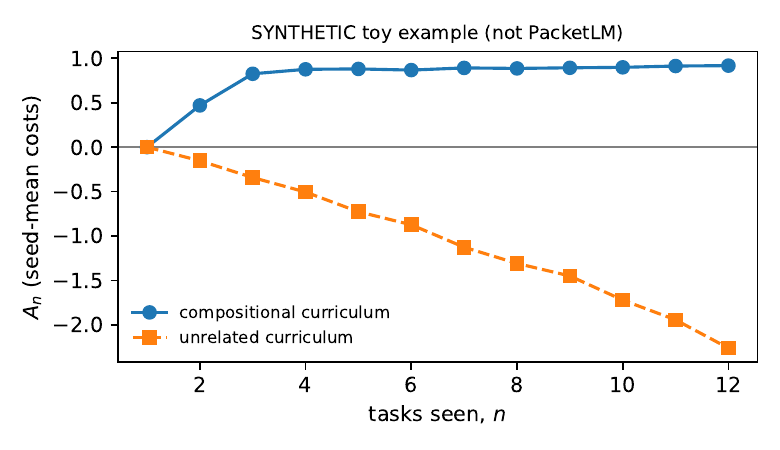

<div align="center">

# Learning Amortization

### Measuring whether learning makes future learning cheaper

[**Read the paper (PDF)**](paper/whitepaper.pdf) · [Markdown version](paper/whitepaper.md) · [Literature check](docs/LITERATURE.md) · [Review notes](REVIEW.md)


</div>

---

A system that **knows more** after training is not necessarily a system that has become **better at learning**.
*Learning amortization* turns that difference into a number. It compares the **total cost** a continual learner pays to reach a fixed accuracy target on every task of a sequence with the cost a reference learner pays on the **same** sequence. Every lifecycle cost of what was learned is charged, not just the training steps.

```math
A_n(L \,\Vert\, R) \;=\; 1 - \frac{C_L(n)}{C_R(n)},
\qquad
C_L(n) \;=\; \sum_{i=0}^{n}\ \sum_{k \in \mathcal{K}} c_{i,k}(L),
\qquad
\mathcal{K} = \{\text{acq},\ \text{ver},\ \text{sto},\ \text{ret},\ \text{mnt},\ \text{exe}\}
```

Here $c_{i,k}(L)$ is the cost of component $k$ (acquisition, verification, storage, retrieval, maintenance, execution) that learner $L$ incurs on task $i$ until it first meets the pre-declared accuracy target. Index $i=0$ holds one-time setup costs. **$A_n > 0$ means past learning paid for part of later learning.** $A_n < 0$ means the learned material costs more to keep and consult than it saves; this is the classical *utility problem*.

## Why this matters

- **Accuracy gains can hide costs.** A large pre-built library or an expensive lookup can raise zero-shot accuracy and still make the system more expensive overall. Speedup-learning research measured this decades ago (Minton, 1990). $A_n$ charges for storage, retrieval and maintenance, so the cost shows up.
- **Matched accuracy makes the comparison fair.** Costs are compared only at the same accuracy target ("cost-to-target"), so a learner cannot look cheap by being worse.
- **It separates two claims.** First-order amortization ($A_n>0$) means earlier learning helps later learning. *Learning to learn* is the stronger claim that the savings grow with experience on genuinely new tasks. The paper gives separate instruments for it: novelty-stratified amortization, fork-and-discard probe curves and a trend test.

## What the paper establishes

All results are proved in the paper and each has an executable test in [`tests/`](tests).

| Result | Statement |
|---|---|
| Range, sign, units (Prop. 1) | $A_n \le 1$; $A_n$ is unbounded below; it is invariant to the unit of cost but **not** to relative prices across resources, so results must be reported per resource |
| Weighted average (Prop. 1v) | $A_n = \sum_{i=0}^n \omega_i a_i$ with $\omega_i = c_i(R)/C_R(n)$, so expensive tasks dominate by design |
| Decomposition (Prop. 2) | $A_n = \sum_k D_{n,k}$, which shows exactly which component saves and which is overhead |
| Asymptotics (Prop. 3) | $A_n \to 1-\gamma_L/\gamma_R$; one-time costs vanish, so $A_\infty$ must be reported together with $A_N$ and break-even |
| Break-even (Prop. 4) | Under constant costs, $n^\star = \lfloor \Delta_0/\delta \rfloor + 1$ |
| **Link to forward transfer (Prop. 5)** | Continual World's AUC forward transfer equals $1 - I(p)/I(p^b)$: an amortization ratio over training steps, averaged over all accuracy thresholds |
| Censoring (Prop. 6) | Censoring in the learner makes $\hat A$ optimistic; censoring in the reference makes it pessimistic |

**Is this new?** Partly. We found no established metric called "learning amortization". Its ingredients are well established: time-to-threshold (Taylor & Stone, 2009), area-based forward transfer (Wołczyk et al., 2021), resource-aware continual-learning metrics (Díaz-Rodríguez et al., 2018), compute to a fixed performance level (Hernandez & Brown, 2020) and the utility problem (Minton, 1990). The contribution is a **synthesis and a measurement protocol**: one full-lifecycle, accuracy-matched definition, with proofs, controls and statistics. See [`docs/LITERATURE.md`](docs/LITERATURE.md), where every citation is checked against Crossref, arXiv or the publisher.

## Quickstart

```bash
git clone https://github.com/jacksonjp0311-gif/learning-amortization
cd learning-amortization
pip install -e ".[test,figures]"      # numpy is the only runtime dependency
pytest -q                             # 32 tests: every proposition is checked
python examples/synthetic_toy.py      # synthetic worked example (~3 s)
```

### From Python

```python
import numpy as np
from amortization import amortization, estimate

# Per-task costs; column 0 = one-time setup. One row per seed, paired across arms.
C_cont = np.array([[50, 40, 22, 15, 9], [55, 38, 25, 14, 10], [48, 42, 20, 16, 8]], float)
C_base = np.array([[ 0, 40, 41, 39, 40], [ 0, 42, 40, 41, 38], [ 0, 39, 40, 40, 41]], float)

amortization(C_cont[0], C_base[0])   # 0.15 for seed 1
print(estimate(C_cont, C_base))
# A_4 = +0.1435 [+0.1180, +0.1625] (95% paired bootstrap, S=3); ...; sign-flip p=0.25
```

With only three seeds, the exact sign-flip test cannot go below $p = 2/2^3 = 0.25$. You need at least 6 seeds before $p < 0.05$ is even possible.

### From a cost log

```bash
python -m amortization examples/results/compositional_costs.csv --cont library --base base
# add --weights '{"ops": 1, "bytes": 0.001}' when the log has several resources
```

A cost log is a CSV with one row per measured increment:

| column | meaning |
|---|---|
| `arm` | learner or control name, e.g. `continual`, `empty_memory` |
| `seed` | seed that generated the task sequence (shared across arms, so runs are paired) |
| `task` | task index; `0` = one-time setup |
| `component` | `acquisition` · `verification` · `storage` · `retrieval` · `maintenance` · `execution` |
| `resource` | e.g. `ops`, `cpu_s`, `byte_s`, `oracle_queries`, `teacher_turns` |
| `amount` | non-negative measured amount |
| `censored` | `1` if the arm did not reach the accuracy target on this task within budget |

## Synthetic worked example

> **SYNTHETIC — not PacketLM and not any real system.** This is a toy enumerative program-search world. Its operation counts are real, but the world is made up.

The same library mechanism is tested on two curricula, with 20 seeds and 12 tasks each:

| | compositional curriculum | unrelated curriculum |
|---|---:|---:|
| $\hat A_{12}$ [95% paired bootstrap CI] | **0.917** [0.869, 0.941] | **−2.261** [−2.539, −1.975] |
| trend of per-task log savings | +0.147 / task | −0.137 / task |
| break-even $n^\star$ | 2 | never |
| main driver ($D_k$) | acquisition +0.847 | acquisition −1.993 |

<p align="center"></p>

When tasks compose, the library pays for itself almost at once. When they do not, every stored entry enlarges the search, and the metric reports a large *negative* amortization. This is the utility problem, caught by the same metric. Section 9 of the paper gives the full accounting, including censoring: the base arm was censored (budget or depth limit reached) on 12 of 240 tasks, which makes $0.917$ a lower bound.

## Controls the protocol requires

| Control | What a positive $A_n(L\Vert\text{control})$ shows |
|---|---|
| Empty-memory | Carried-over state pays for itself (default reference) |
| Frozen | Continued learning helps beyond the initial library |
| Primitive-only | Reuse of acquired *procedures*, not just facts, drives savings |
| Shuffled-evidence | Savings depend on the *content* of experience, not its volume |
| Symbolic reference | The learner is competitive in absolute terms |
| Geometry-disabled | Savings come from the geometric (Bitwork) mechanism |
| Order-shuffled, exact-repeat cache | Not a curriculum artefact, and more than caching |

## Status and scope

The motivating application is [PacketLM](https://github.com/jacksonjp0311-gif/PacketLM), a non-transformer, sparse-binary ("Bitwork") learner. **This repository reports no PacketLM results.** Section 10 of the paper is a *planned* evaluation protocol, and results will be added only from verified, reproducible artifacts.

## Repository layout

```
amortization/          reference implementation (numpy only)
  metric.py            A_n, marginal, tail, break-even, decomposition, cost logs
  stats.py             ratio-of-means estimator, delta-method SE, paired bootstrap,
                       exact sign-flip test, trend slope
  transfer.py          forward-transfer link (Prop. 5)
  __main__.py          CLI report from a cost-log CSV
tests/                 one or more tests per proposition
examples/
  synthetic_toy.py     SYNTHETIC worked example; writes examples/results/
paper/
  whitepaper.tex/.pdf  the paper (canonical)
  whitepaper.md        generated Markdown version
  refs.bib             verified bibliography
scripts/build_markdown.py   tex -> md with cross-references resolved from .aux
docs/LITERATURE.md     citation verification and novelty assessment
REVIEW.md              independent review notes and what was fixed
```

## Code ↔ paper map

| Paper | Code |
|---|---|
| Def. 2 cost functional, declared prices | `CostLog.component_costs`, `CostLog.task_costs(weights=...)` |
| Def. 5 $A_n$ | `amortization`, `amortization_curve` |
| Def. 6 marginal / tail | `marginal_amortization`, `tail_amortization` |
| Def. 7, Prop. 4 break-even | `break_even` |
| Prop. 2 decomposition | `component_contributions` |
| Prop. 5 forward transfer | `transfer.threshold_cost_integral`, `transfer.forward_transfer_cw` |
| Sec. 5.2 trend | `trend_slope` |
| Sec. 6.2 estimators and tests | `point_estimate`, `delta_method_se`, `bootstrap_ci`, `sign_flip_test`, `estimate` |

## Building the paper

```bash
sudo apt-get install texlive-latex-recommended texlive-latex-extra texlive-science latexmk pandoc poppler-utils
make paper markdown     # or: cd paper && latexmk -pdf whitepaper.tex
```

This repository has no CI workflows on purpose. Tests and builds run locally.

## Citation

```bibtex
@techreport{jackson2026amortization,
  title       = {Learning Amortization: Measuring Whether Learning Makes Future Learning Cheaper},
  author      = {Jackson, James},
  institution = {GitHub},
  type        = {Working paper},
  number      = {v0.1},
  year        = {2026},
  url         = {https://github.com/jacksonjp0311-gif/learning-amortization}
}
```

GitHub's "Cite this repository" button reads [`CITATION.cff`](CITATION.cff).

## License

Code: [MIT](LICENSE). Paper and figures: [CC BY 4.0](LICENSE-PAPER.md).
