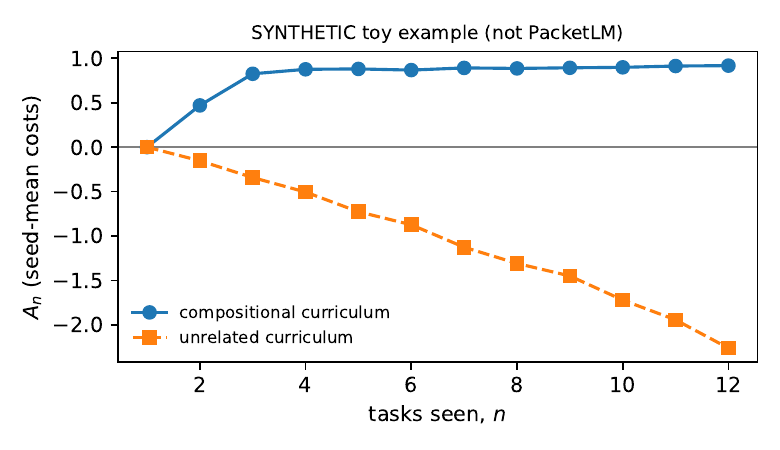

# Learning Amortization: Measuring Whether Learning Makes Future Learning Cheaper

**James Jackson** · Working paper v0.1 · November 2026 · [PDF](whitepaper.pdf) (canonical; this Markdown is generated from the LaTeX source by `scripts/build_markdown.py`)

## Abstract

A learning system that accumulates knowledge is not necessarily a system that gets better at learning. We make the distinction measurable. *Learning amortization* compares the *total* cost a continual learner pays to reach a fixed accuracy target on every task of a sequence with the cost paid by a reference learner on the same sequence: $A_n = 1 - C_{\text{continual}}(n)/C_{\text{reference}}(n)$. Costs are charged over the whole lifecycle of what is learned: acquisition, verification, storage, retrieval, maintenance and execution, plus any one-time setup. We give formal definitions and prove the basic properties of the metric: its range and sign, unit invariance (and the precise sense in which it is *not* invariant), an exact weighted-average form, an additive decomposition into cost components, its asymptotic limit and a closed-form break-even point. We show that, for non-decreasing learning curves, the AUC-based forward-transfer metric of Continual World is exactly an amortization ratio whose cost is training steps averaged over all accuracy thresholds, which places the proposal inside existing transfer metrics instead of beside them. We separate first-order amortization (past learning pays for future learning) from second-order evidence of learning to learn (the savings themselves grow with experience), specify paired-seed estimators, confidence intervals, exact tests and censoring bounds, and list the controls and pitfalls that decide whether a positive $A_n$ means anything. A small open-source reference implementation reproduces every quantity, and a clearly labelled synthetic example shows the metric detecting both genuine amortization and the classical “utility problem” in which a growing library makes learning *more* expensive. We then report the first sustained application, to PacketLM, a non-transformer sparse-binary learner. In six pre-registered experiments, five of them independently reproduced, every primary amortization contrast is negative: the persistent learner costs $1.68$ to $18.0$ times the empty-memory reference. Exact engineering narrowed the gap on unrelated tasks from $18.0\times$ to $3.21\times$ without changing a single reply, and cut the growth of per-task cost with $16{,}000$ irrelevant stored facts from $91\times$ to $3.75\times$. The case study yields five methodological results, each formalized with proof: cost ratios obey a chain rule and $1-A$, not $e^{-A}$, is the cost ratio; amortization is valid only under a protocol-equivalent comparison, and a fixed per-invocation overhead provably pulls the measured ratio towards the invocation ratio (here hiding a gap of $18\times$ behind one of $4\times$); unequal completion makes $A$ only partially identified, with sharp bounds; positive asymptotic amortization under unbounded knowledge growth requires *bounded* irrelevant-state scaling, so sublinear growth is not enough; and exactness-preserving optimizations are accuracy-matched cost contrasts.

## 1. Introduction

The central question behind this paper is simple to state: *does a system become better at learning as a consequence of having learned?* Two easier questions are often answered in its place. The first is whether the system knows more after training, which any memory satisfies. The second is whether it is more accurate on a new task straight away (zero-shot forward transfer), which can be bought with an expensive lookup or a large pre-built library whose cost is never charged.

We argue that the right currency for the central question is *cost at matched accuracy*, summed over everything the system has to do to make prior learning usable. Speedup-learning research found decades ago that learned macro-operators, explanation-based rules and chunks can make a problem solver slower, because matching and maintaining a growing store costs more than it saves (Minton 1990; Tambe, Newell, and Rosenbloom 1990). Modern library-learning systems (Ellis et al. 2021; Bowers et al. 2023; Grand et al. 2024) and continual learners face the same trade-off. A metric that ignores storage, retrieval and maintenance can report progress when there is none.

**Contributions.**

This is a measurement paper; it proposes no learning algorithm. Its only empirical claims concern the PacketLM case study, and they are negative.

1.  A **full-lifecycle cost functional** with an explicit accuracy-matching rule (cost-to-target), declared prices and an attribution rule for costs between tasks (Section 3).

2.  The **learning-amortization** family: cumulative $A_n$, marginal $a_i$, asymptotic $A_\infty$ and break-even $n^\star$, with proofs of their properties (Section 4).

3.  An **exact link to forward transfer**: Continual World’s FT metric is an amortization ratio over training steps averaged across accuracy thresholds (Proposition 5).

4.  A separation of **first-order amortization from second-order learning to learn**, via novelty stratification, fork-and-discard probe curves and trend tests (Section 5).

5.  An **estimation and control protocol** with paired seeds, intervals, exact tests and censoring bounds (Sections 6, 7 and 8), and a **reference implementation** with a synthetic worked example (Section 9).

6.  An **empirical case study** of PacketLM over six pre-registered experiments, with a cost decomposition, an irrelevant-state scaling test and independent reproduction (Section 10). It reports no positive amortization.

7.  **Methodological results** from that study: a chain rule for cost ratios and a worked interpretation note (Proposition 7, Remark 2), protocol equivalence (Definition 10, Proposition 8), partial identification under censoring (Proposition 9), an irrelevant-state scaling diagnostic and its relation to asymptotic amortization (Definition 12, Proposition 10), exactness-preserving optimization (Proposition 11), and reporting standards (Section 11.6).

## 2. Related work and novelty assessment

**Learning to learn and meta-learning.**

The idea that experience with earlier tasks should improve learning of later ones is old and well developed. It appears in the edited volume of Thrun and Pratt (1998), in multitask learning (Caruana 1997), in Baxter’s theory of inductive-bias learning (Baxter 2000), and in modern meta-learning (Finn, Abbeel, and Levine 2017; Hospedales et al. 2022). These works mostly measure gains in accuracy or sample efficiency on new tasks; they rarely charge the cost of keeping and consulting what was learned.

**Continual-learning metrics.**

Lopez-Paz and Ranzato (2017) define backward transfer (BWT) and forward transfer (FWT) from an accuracy matrix $R_{j,i}$, the test accuracy on task $i$ after training on task $j$. FWT measures zero-shot accuracy on task $i$ just before it is trained, relative to a random-initialisation baseline. It is an accuracy quantity and carries no cost. Díaz-Rodríguez et al. (2018) add efficiency criteria, including model-size efficiency, sample-storage efficiency and computational efficiency, and combine them with accuracy-based ones in a weighted score. That work is the closest prior art we found for charging resources in continual learning. As far as we can tell, it does not define cost at matched accuracy or a sequence-level savings ratio. Chaudhry et al. (2018) introduce intransigence (inability to learn new tasks), and Chaudhry et al. (2019) introduce the learning-curve area (LCA) as a measure of how quickly a learner acquires new tasks. Wołczyk et al. (2021) measure forward transfer as the normalised area between a continual learner’s training curve and a from-scratch reference; Proposition 5 shows that this is a special case of the ratio studied here. Veniat, Denoyer, and Ranzato (2021) probe several kinds of transfer and report them together with how fast the model grows in size. Chen and Liu (2018) survey lifelong learning more broadly.

**Transfer metrics in reinforcement learning.**

Taylor and Stone (2009) list jumpstart, asymptotic performance, total reward, the transfer ratio and *time to threshold*. Time to threshold is exactly a per-task cost-to-target when cost is measured in samples, and the transfer ratio is an area ratio. Our per-task quantity $a_i$ (Definition 6) generalises time-to-threshold reduction to a multi-component cost.

**Speedup learning and the utility problem.**

Learned macro-operators (Fikes, Hart, and Nilsson 1972), explanation-based generalisation (Mitchell, Keller, and Kedar-Cabelli 1986) and Soar’s chunking (Laird, Rosenbloom, and Newell 1986) all aim to make future problem solving cheaper. Minton (1990) measured the utility of a learned control rule as its average savings times its application frequency minus its average match cost, and showed that unrestricted learning can slow the solver down. Tambe, Newell, and Rosenbloom (1990) traced the same effect to expensive chunks. Our component decomposition (Proposition 2) is the sequence-level analogue of Minton’s utility, extended to storage, maintenance and verification.

**Library learning.**

DreamCoder (Ellis et al. 2021) grows a library of reusable functions and a recognition model that guides search, and reports that solving more tasks makes later tasks easier to solve. Stitch (Bowers et al. 2023) makes library compression far faster, and LILO (Grand et al. 2024) combines LLM-guided synthesis with Stitch compression and automatic documentation. These systems are the natural home for amortization measurements, but their reported metrics are mostly tasks solved and search time under a budget, without a full-lifecycle cost accounting at matched accuracy.

**Amortized inference and “amortised learning”.**

In probabilistic inference, amortization means reusing past computation so that future inferences are cheaper. Gershman and Goodman (2014) argue that people cache and reuse sub-inferences. Wenliang et al. (2020) use the name *amortised learning* for a wake-sleep method that learns to predict maximum-likelihood parameter updates. These usages are close in spirit, since earlier computation pays for later computation, but they name algorithms, not a cross-task evaluation metric. To avoid confusion, we always say *learning amortization* and always mean the metric $A_n$.

**Efficiency accounting.**

Schwartz et al. (2020) argue for reporting the computational price of results. Hernandez and Brown (2020) measure algorithmic progress as the training compute needed to reach a *fixed* performance level (AlexNet-level ImageNet accuracy), which is the same cost-at-matched-accuracy principle we use. Dehghani et al. (2022) show that different cost indicators (FLOPs, parameters, throughput) can rank models differently, which motivates our per-resource reporting rule (Proposition 1(iii)). Chollet (2019) defines intelligence as skill-acquisition efficiency relative to priors and experience. $A_n$ is a much narrower, operational quantity, but it shares the view that efficiency of acquisition, not skill alone, is what should be measured.

**Novelty assessment.**

We searched for the phrase “learning amortization” and for metrics that combine cost-at-matched-accuracy, a sequence-level savings ratio and full lifecycle costs. We found no established metric under this name. The ingredients are not new: time-to-threshold (Taylor and Stone 2009), area-based forward transfer (Wołczyk et al. 2021), resource-aware continual-learning criteria (Díaz-Rodríguez et al. 2018), compute to a fixed performance level (Hernandez and Brown 2020), and the utility analysis of speedup learning (Minton 1990). Our contribution is therefore a *synthesis and a protocol*. It has one definition that charges every lifecycle cost at matched accuracy, proofs of the properties needed to interpret it, an exact reduction showing how an established forward-transfer metric fits inside it, and a control and statistics protocol aimed at separating learning to learn from accumulation. We make no stronger novelty claim.

## 3. Formal setup

<div id="def:protocol" class="definition">

**Definition 1** (Task sequence and protocol). A seed $s$ determines, through a fixed generator, a task sequence $\mathcal{T}^{(s)} = (T_1,\dots,T_N)$. Each task $T_i$ provides an interaction source (examples, teaching turns, oracle queries) and a *sealed* evaluation set $E_i$ that no learner reads. A learner $L$ has a state $M$ (memory, library, parameters). A *continual* learner starts task $i$ from the state $M_{i-1}$ left by task $i-1$, starting from an initial state $M_0$. A *reference* learner $R$ runs on the same $\mathcal{T}^{(s)}$ under a protocol specified in Section 7; the default reference resets its state to $M_0$ before every task.

</div>

<div id="def:cost" class="definition">

**Definition 2** (Cost functional). Let $\mathcal{K}= \lbrace \mathrm{acq},\mathrm{ver},\mathrm{sto},\mathrm{ret},\mathrm{mnt},\mathrm{exe}\rbrace$ be the cost components and $\mathcal{R}$ a finite set of measured resources (e.g. primitive operations, CPU-seconds, byte-seconds of storage, oracle queries, teacher turns). For task index $i\in\lbrace 0,\dots,N\rbrace$, component $k$ and resource $r$, let $q_{i,k,r}\ge 0$ be the measured amount. Index $i=0$ collects one-time costs paid before $T_1$. Given a price vector $w\in\mathbb{R}_{\ge 0}^{\mathcal{R}}$ *declared before the experiment*,

```math
c_{i,k} = \sum_{r\in\mathcal{R}} w_r\, q_{i,k,r}, \qquad c_i = \sum_{k\in\mathcal{K}} c_{i,k}.\qquad\qquad(1)
```

*Attribution rule.* Every cost incurred from the moment the learner is ready to accept $T_i$ until the moment it is ready to accept $T_{i+1}$ is charged to $i$; costs before $T_1$ are charged to $0$. Thus post-task consolidation, deduplication and checkpointing are charged to the task that triggered them. Experimenter-side evaluation on $E_i$ is not charged. The learner’s own execution to produce answers for $E_i$ is charged as $c_{i,\mathrm{exe}}$.

</div>

The components have the following meanings. *Acquisition* covers search, candidate generation, parameter updates and interaction with the teacher or oracle. *Verification* covers checking candidates against evidence, consistency checks and re-verification after corrections or retractions. *Storage* is the holding cost of the state, measured in a resource such as byte-seconds, $\int |M(t)|\thinspace dt$ over the task’s interval, so a library that is never used still costs something. *Retrieval* covers indexing, lookup and matching of stored items, which is Minton’s match cost. *Maintenance* covers consolidation, compression, deduplication, dependency propagation, invalidation and checkpoint I/O. *Execution* is running the acquired capability.

<div id="def:ctt" class="definition">

**Definition 3** (Cost-to-target). Fix, before the experiment, an accuracy target $\alpha_i\in(0,1]$ and a budget $B_i>0$ for every task. Let $\mathrm{acc}_i(L,t)$ be the accuracy on $E_i$ of the hypothesis $L$ has committed to after spending cost $t$ on $T_i$. The learning phase of $T_i$ ends at a stopping point $\tau_i(L)$, measured in cost spent on $T_i$ and defined in one of two ways, declared in advance:

- *anytime learners*: $\tau_i(L) = \min\bigl(B_i,\ \inf\lbrace t\ge 0: \mathrm{acc}_i(L,t)\ge \alpha_i\rbrace \bigr)$, where the experimenter evaluates checkpoints on $E_i$ without feeding any result back to the learner;

- *self-stopping learners*: $\tau_i(L)=\min(B_i,\sigma_i)$, where $\sigma_i$ is the moment the learner commits by its own criterion.

$c_i(L)$ is the total cost charged to $i$ by Definition 2: the cost up to $\tau_i$ plus the post-task costs (consolidation, maintenance, execution on $E_i$) the attribution rule assigns to $i$. The censoring indicator is $\delta_i(L)=\mathbf{1}[\mathrm{acc}_i(L,\tau_i)<\alpha_i]$.

</div>

<div class="remark">

*Remark 1* (Accuracy matching). A task’s cost counts as *matched* for an arm only if $\delta_i=0$. Cost-to-target makes accuracies comparable by construction. The alternative, a fixed budget with an equivalence test on accuracy (e.g. two one-sided tests with a declared margin), is also valid but must be declared in advance. Comparing costs at different accuracies is not valid.

</div>

<div id="def:cum" class="definition">

**Definition 4** (Cumulative cost). $C_L(n) = \sum_{i=0}^{n} c_i(L)$ for $n=0,\dots,N$.

</div>

<div id="def:A" class="definition">

**Definition 5** (Learning amortization). For a learner $L$, a reference $R$ and a horizon $1\le n\le N$ with $C_R(n)>0$,

```math
\boxed{\;A_n(L\,\Vert \,R) \;=\; 1-\frac{C_L(n)}{C_R(n)}\;}\qquad\qquad(2)
```

We write $A_n$ when $L$ and $R$ are clear from context. $A_n>0$ means $L$ paid less than $R$ in total to reach the same targets on the first $n$ tasks.

</div>

<div id="def:marg" class="definition">

**Definition 6** (Marginal and asymptotic amortization). For $i\ge 1$ with $c_i(R)>0$, the marginal amortization is $a_i = 1 - c_i(L)/c_i(R)$, and we set $a_0 = 1-c_0(L)/c_0(R)$ when $c_0(R)>0$. The asymptotic amortization is $A_\infty = \lim_{n\to\infty} A_n$ when the limit exists. The tail-window estimator with window $k$ is

```math
A^{(k)}_N = 1-\frac{\sum_{i=N-k+1}^{N} c_i(L)}{\sum_{i=N-k+1}^{N} c_i(R)}.
```

</div>

<div id="def:be" class="definition">

**Definition 7** (Break-even point). $n^\star = \min\lbrace n\in\lbrace 1,\dots,N\rbrace : A_m>0 \text{ for all } m\in\lbrace n,\dots,N\rbrace \rbrace$, and $n^\star$ is undefined if $A_N\le 0$. Requiring positivity on the rest of the horizon prevents a temporary crossing from being reported as break-even.

</div>

## 4. Properties

All proofs are short and given inline. Each property has an executable check in `tests/`.

<div id="prop:basic" class="proposition">

**Proposition 1** (Basic properties). Let $C_R(n)>0$.

(i) *Range and sign.* $A_n\le 1$, with equality if and only if $C_L(n)=0$, and $A_n$ is unbounded below. $A_n>0$, $=0$ or $<0$ according as $C_L(n)<$, $=$ or $>C_R(n)$.

(ii) *Unit invariance.* Replacing $w$ by $\lambda w$ for any $\lambda>0$ leaves $A_n$ unchanged. In particular, with a single resource, $A_n$ does not depend on the unit.

(iii) *No invariance to relative prices.* With two or more resources, changing the *relative* prices can change the sign of $A_n$. Results must therefore be reported per resource as well as for the declared $w$.

(iv) *Log form and asymmetry.* With $\ell_n = \log C_R(n) - \log C_L(n)$ (for $C_L(n)>0$), $A_n = 1-e^{-\ell_n}$. Moreover $\ell_n(R\Vert L)=-\ell_n(L\Vert R)$, whereas $A_n(R\Vert L) = -A_n(L\Vert R)/(1-A_n(L\Vert R))$.

(v) *Weighted average.* Let $P=\lbrace i\le n: c_i(R)>0\rbrace$ and $Z=\lbrace i\le n: c_i(R)=0\rbrace$. Then

```math
A_n = \sum_{i\in P}\omega_i\, a_i \;-\; \sum_{i\in Z}\frac{c_i(L)}{C_R(n)},\qquad \omega_i = \frac{c_i(R)}{C_R(n)},\quad \sum_{i\in P}\omega_i = 1 .\qquad\qquad(3)
```

In the common case $c_0(R)=0$ (a reference with no setup), the learner’s whole setup cost enters through the second sum as a pure penalty. If $Z=\varnothing$, then $A_n$ is exactly the $\omega$-weighted mean of the marginal amortizations.

</div>

<div class="proof">

*Proof.* (i) Costs are non-negative, so $C_L(n)/C_R(n)\ge 0$, and the ratio is $0$ only when $C_L(n)=0$. Letting $C_L(n)\to\infty$ shows that $A_n$ is unbounded below. The sign statement follows by rearranging the definition. (ii) Both cumulative costs are linear in $w$ by (1), so the common factor $\lambda$ cancels. (iii) Consider one task, $c_0=0$ and two resources (operations and memory). Let $L$ use $(1,10)$ and $R$ use $(10,0)$. With prices $(1,0.1)$, $A_1 = 1-2/10 = 0.8$. With prices $(1,10)$, $A_1 = 1-101/10 = -9.1$. (iv) $C_L/C_R = e^{-\ell_n}$. Swapping the arms gives $1-C_R/C_L = 1-1/(1-A_n)$. (v) $1-\frac{C_L(n)}{C_R(n)} = \sum_{i\le n} \frac{c_i(R)-c_i(L)}{C_R(n)}$. For $i\in P$ the summand equals $\frac{c_i(R)}{C_R(n)}\bigl(1-\frac{c_i(L)}{c_i(R)}\bigr)=\omega_i a_i$, and for $i\in Z$ it equals $-c_i(L)/C_R(n)$. Finally $\sum_{i\in P}c_i(R)=C_R(n)$. ◻

</div>

Item (v) shows that cumulative amortization weights each task by its *reference* cost, so hard tasks dominate. This is deliberate, because it reports savings in the currency actually spent. An unweighted mean of $a_i$, as used for FT by Wołczyk et al. (2021), answers a different question and should be labelled as such. Because of (iv), averages of $A$ across seeds should be taken on the $\ell$ scale or as ratios of sums, never as unweighted arithmetic means of per-seed $A$ values.

<div id="prop:decomp" class="proposition">

**Proposition 2** (Component decomposition). Write $C_{L,k}(n)=\sum_{i\le n}c_{i,k}(L)$ and similarly for $R$. Then

```math
A_n = \sum_{k\in\mathcal{K}} D_{n,k},\qquad D_{n,k} = \frac{C_{R,k}(n)-C_{L,k}(n)}{C_R(n)} .\qquad\qquad(4)
```

</div>

<div class="proof">

*Proof.* $C_R(n)-C_L(n) = \sum_k \bigl(C_{R,k}(n)-C_{L,k}(n)\bigr)$. Divide by $C_R(n)$. ◻

</div>

<div id="cor:utility" class="corollary">

**Corollary 1** (Utility condition). Partition $\mathcal{K}$ into components on which $L$ saves ($D_{n,k}\ge 0$) and overheads ($D_{n,k}<0$). Then $A_n>0$ if and only if the total savings exceed the total overheads:

```math
\sum_{k: D_{n,k}\ge 0}\bigl(C_{R,k}-C_{L,k}\bigr) \;>\; \sum_{k: D_{n,k}<0}\bigl(C_{L,k}-C_{R,k}\bigr).
```

A memoryless reference typically has $C_{R,\mathrm{ret}}=C_{R,\mathrm{mnt}}=0$, so for a library learner retrieval and maintenance enter only as overheads. This is Minton’s utility problem (Minton 1990) at the scale of a whole sequence.

</div>

<div id="prop:asym" class="proposition">

**Proposition 3** (Asymptotic limit). Suppose $c_0(L),c_0(R)<\infty$ and the per-task averages converge: $\frac1n\sum_{i=1}^n c_i(L)\to\gamma_L$ and $\frac1n\sum_{i=1}^n c_i(R)\to\gamma_R>0$. Then

```math
A_\infty = \lim_{n\to\infty}A_n = 1-\frac{\gamma_L}{\gamma_R}.
```

</div>

<div class="proof">

*Proof.* $\frac{C_L(n)}{C_R(n)} = \frac{c_0(L)/n + \frac1n\sum_{i=1}^n c_i(L)}{c_0(R)/n+\frac1n\sum_{i=1}^n c_i(R)}\to\frac{\gamma_L}{\gamma_R}$, since the denominator tends to $\gamma_R>0$. ◻

</div>

One-time costs vanish from $A_\infty$. A system with an enormous pre-built library can therefore look excellent asymptotically while never repaying its setup within any realistic horizon. $A_\infty$ or $A^{(k)}_N$ must always be reported together with $A_N$ at the actual horizon and with $n^\star$.

<div id="prop:be" class="proposition">

**Proposition 4** (Break-even under constant costs). Let $c_0(L)=c_0(R)+\Delta_0$ with $c_0(R)\ge 0$ and $c_0(L)\ge 0$, and for $i\ge1$ let $c_i(R)=\gamma>0$ and $c_i(L)=\gamma-\delta$ with $0<\delta\le\gamma$. Then

```math
A_n = \frac{n\delta-\Delta_0}{c_0(R)+n\gamma},
```

which is non-decreasing in $n$ when $\Delta_0\ge 0$ and tends to $\delta/\gamma$. Consequently $n^\star = \lfloor \Delta_0/\delta\rfloor+1$ if $\Delta_0\ge 0$ and $n^\star=1$ if $\Delta_0<0$ (for $N\ge n^\star$).

</div>

<div class="proof">

*Proof.* $1-\frac{c_0(R)+\Delta_0+n(\gamma-\delta)}{c_0(R)+n\gamma} = \frac{n\delta-\Delta_0}{c_0(R)+n\gamma}$. Its derivative in $n$ has the sign of $\delta c_0(R)+\gamma\Delta_0$, which is $\ge 0$ when $\Delta_0\ge0$. So when $\Delta_0\ge 0$, $A_n>0$ exactly when $n>\Delta_0/\delta$ and positivity then persists, giving the first integer above $\Delta_0/\delta$. When $\Delta_0<0$ the numerator is positive for all $n\ge1$. ◻

</div>

### 4.1 Relation to forward transfer

Let a learning curve on a task be $p_0,\dots,p_{D-1}\in[0,1]$, the performance after $k$ units of training cost, with budget $D$. Define the first-hit cost $t(\alpha)=\min\lbrace k: p_k\ge\alpha\rbrace$ (or $D$ if the target is never reached), the normalised area $\mathrm{AUC}=\frac1D\sum_k p_k$, and

```math
I(p) = \int_0^1 \min\bigl(t(\alpha),D\bigr)\,d\alpha ,
```

the cost-to-target averaged uniformly over all targets $\alpha$ and censored at the budget.

<div id="prop:ft" class="proposition">

**Proposition 5** (Forward transfer is an amortization ratio). If $p$ is non-decreasing, then (i) $\mathrm{AUC} = 1 - I(p)/D$. Hence (ii), for non-decreasing $p$ (continual) and $p^b$ (reference) with $\mathrm{AUC}^b<1$, the Continual World forward transfer (Wołczyk et al. 2021) satisfies

```math
\mathrm{FT} = \frac{\mathrm{AUC}-\mathrm{AUC}^b}{1-\mathrm{AUC}^b} = 1-\frac{I(p)}{I(p^b)} .
```

</div>

<div class="proof">

*Proof.* (i) $p_k = \int_0^1 \mathbf{1}[p_k\ge\alpha]\thinspace d\alpha$, so $\sum_k p_k = \int_0^1 \bigl|\lbrace k: p_k\ge\alpha\rbrace \bigr|\thinspace d\alpha$. For a non-decreasing curve, $\lbrace k:p_k\ge\alpha\rbrace =\lbrace t(\alpha),\dots,D-1\rbrace$, which has $D-\min(t(\alpha),D)$ elements. Dividing by $D$ gives the claim. (ii) By (i), $\mathrm{AUC}-\mathrm{AUC}^b = (I(p^b)-I(p))/D$ and $1-\mathrm{AUC}^b = I(p^b)/D>0$. ◻

</div>

The same proof works in continuous time, which is the form used by Wołczyk et al. (2021). For a non-decreasing $p:[0,\Delta]\to[0,1]$, Tonelli’s theorem gives $\int_0^\Delta p(t)\thinspace dt=\int_0^1 \bigl(\Delta-\min(t(\alpha),\Delta)\bigr)\thinspace d\alpha$ with $t(\alpha)=\inf\lbrace t:p(t)\ge\alpha\rbrace$. FT is thus learning amortization for a single task in which cost is training steps only, the target is averaged over $[0,1]$ instead of fixed, costs are censored at the budget, and tasks are then averaged without weights. $A_n$ keeps the ratio form but fixes a declared target, charges every lifecycle component and aggregates by cost. For curves that rise and then collapse, AUC and $I$ disagree. The test suite includes a counterexample, so monotonicity (or a running maximum) must be stated whenever this correspondence is used. By contrast, GEM’s FWT (Lopez-Paz and Ranzato 2017) is a zero-shot accuracy difference. Positive FWT is neither necessary nor sufficient for $A_n>0$: a learner can be accurate zero-shot only through an expensive retrieval, or have zero zero-shot accuracy and still learn each new task cheaply.

## 5. First-order amortization versus learning to learn

### 5.1 Two different claims

$A_n>0$ is a *first-order* claim: what was learned earlier pays for part of what is learned later. That can happen without the learning process improving at all, for example when later tasks repeat earlier ones and the learner retrieves stored answers. The stronger, *second-order* claim is that the learner’s capacity to acquire genuinely new capabilities grows with experience. The three instruments below target the second claim.

<div id="def:novel" class="definition">

**Definition 8** (Novelty-stratified amortization). Before running, the generator labels each task *novel* or *familiar* by a criterion that does not depend on outcomes. A task is novel, for instance, if its solution is not equivalent to any solution of an earlier task and it uses relations or entities withheld from earlier tasks. With $\mathcal{N}$ the novel tasks among the first $n$,

```math
A_n^{\mathrm{nov}} = 1-\frac{c_0(L)+\sum_{i\in\mathcal{N}}c_i(L)}{c_0(R)+\sum_{i\in\mathcal{N}}c_i(R)}.
```

Both arms’ full setup costs are kept. Write $X_L=\sum_{i\in\mathcal{N}}c_i(L)$ and $X_R=\sum_{i\in\mathcal{N}}c_i(R)>0$. Compared with the setup-free ratio $1-X_L/X_R$, $A_n^{\mathrm{nov}}$ is never larger, that is, conservative for the learner, if and only if $c_0(L)\thinspace X_R\ge c_0(R)\thinspace X_L$ (cross-multiply the two ratios). This holds whenever $c_0(R)=0$, as for the default empty-memory reference. The weaker condition $c_0(L)\ge c_0(R)$ is *not* sufficient: equal setups shrink a negative $A^{\mathrm{nov}}_n$ towards $0$ when $X_L>X_R$.

</div>

<div id="def:probe" class="definition">

**Definition 9** (Fork-and-discard probe curve). Fix sealed probe tasks $P_1,\dots,P_m$ that never enter any learner’s state. After task $k$ of the sequence, copy the state $M_k$, solve each probe from the copy, record the cost-to-target $c_{P_j}(M_k)$, then discard the copy. The probe amortization is

```math
\Pi(k) = 1-\frac{\sum_j c_{P_j}(M_k)}{\sum_j c_{P_j}(M_0)} .
```

</div>

Because the probes are discarded, $\Pi(k)$ measures how cheap *new* learning has become at stage $k$ without contaminating the sequence. Evidence for learning to learn is a $\Pi(k)$ that rises with $k$ on probes that are novel by the criterion of Definition 8.

### 5.2 Trend test

Let $\ell_{s,i} = \log c_i^{(s)}(R)-\log c_i^{(s)}(L)$ be the per-task log ratio in seed $s$, and $\bar\ell_i$ its mean over seeds. The trend $\beta$ is the ordinary least-squares slope of $\bar\ell_i$ on $i$, with a bootstrap interval obtained by resampling seeds. A positive $\beta$ means the per-task savings grow along the sequence, which is the signature of compounding. $\beta\approx 0$ with $A_n>0$ means a fixed advantage, for example a useful initial library. $\beta$ measures growth in *relative* savings. If later tasks are harder for the reference while $L$’s absolute cost stays flat, $\beta>0$ even though $L$’s learning has not accelerated in absolute terms. $\beta$ must therefore be read alongside absolute per-task costs, $\Pi(k)$ and the order-shuffled control.

## 6. Estimation and inference

### 6.1 Design

Run $S$ independent seeds. Within a seed, every arm sees the same task sequence, the same splits and the same sealed sets, which makes the design *paired*. Let $X_s = C_L^{(s)}(n)$ and $Y_s = C_R^{(s)}(n)$. Before running, fix and record the following: $\alpha_i$, $B_i$, $w$, the generator, $S$, $n$, the novelty criterion, the primary comparison and the analysis code version. Where possible, use deterministic operation counts as the primary cost, and wall-clock time on pinned cores, with repetitions, as a secondary cost.

### 6.2 Estimators, intervals and tests

The population quantity is $A_n = 1-\mathbb{E}X/\mathbb{E}Y$, the savings on the total spent by a population of runs. Its plug-in estimator is the ratio of means,

```math
\hat A_n = 1-\frac{\sum_s X_s}{\sum_s Y_s},\qquad\qquad(5)
```

which is consistent by the strong law of large numbers and continuity of $(x,y)\mapsto 1-x/y$ at $(\mathbb{E}X,\mathbb{E}Y)$ with $\mathbb{E}Y>0$. The mean of per-seed $A$ values estimates a different quantity, $1-\mathbb{E}[X/Y]$, and is distorted by the asymmetry noted in Proposition 1(iv). We do not use it. As a robustness check we also report the geometric form $1-\exp(-\bar\ell)$ with $\bar\ell = \frac1S\sum_s \ell_s$ and $\ell_s=\log Y_s-\log X_s$.

*Delta-method standard error.* With $\hat\rho = \bar X/\bar Y$ and residuals $d_s = X_s-\hat\rho Y_s$ (which sum to zero),

```math
\widehat{\mathrm{SE}}(\hat A_n) = \frac{1}{\bar Y}\sqrt{\frac{1}{S(S-1)}\sum_{s=1}^S d_s^2 } .\qquad\qquad(6)
```

*Paired bootstrap.* Resample whole seeds with replacement, using the same indices for both arms, recompute (5), and report percentile intervals (Efron and Tibshirani 1993). For small $S$, treat intervals as descriptive and report every per-seed value, following Agarwal et al. (2021).

*Exact test.* Under $H_0$, the distribution of $\ell_s$ is symmetric about $0$ (no amortization). The sign-flip permutation test uses $|\bar\ell|$ and enumerates all $2^S$ sign patterns (for large $S$ the reference implementation draws random patterns and reports $(1+m)/(1+B)$, where $m$ of the $B$ draws are at least as extreme as the observed statistic). The smallest attainable two-sided $p$-value is $2/2^S$, so $S\ge 6$ seeds are needed before $p<0.05$ is even possible. This null concerns the per-seed log ratios, the geometric form of $A_n$; it complements, and is not identical to, the ratio-of-means estimand (5). The Wilcoxon signed-rank test on $\ell_s$ is an alternative. Across several controls, correct for multiplicity (e.g. Holm). On paired designs and the dangers of naive $t$-tests over resampled splits, see Dietterich (1998).

### 6.3 Censoring

A censored task (Definition 3) is recorded at the cost actually spent: the budget, or the stopping cost of a committed hypothesis that missed the target. Reaching the target in the same run would have required at least that much, so the recorded cost is a *lower* bound on the true cost-to-target.

<div id="prop:cens" class="proposition">

**Proposition 6** (Censoring bounds). Let $\tilde C_L,\tilde C_R$ be the recorded and $C_L\ge\tilde C_L$, $C_R\ge\tilde C_R$ the true cumulative costs. If only $L$ has censored tasks ($C_R=\tilde C_R$), the recorded $\tilde A_n$ is an *upper* bound on $A_n$ (optimistic). If only $R$ has censored tasks, $\tilde A_n$ is a *lower* bound (pessimistic). If both do, the direction is undetermined.

</div>

<div class="proof">

*Proof.* $A_n$ is decreasing in $C_L$ and increasing in $C_R$ for $C_R>0$. ◻

</div>

Censoring counts per arm must be reported. Dropping censored tasks from the analysis is selection on the outcome, and is not allowed.

## 7. Required controls

Each control is a reference $R$ in $A_n(L\Vert R)$ and answers one question. Table 1 lists them.

<div id="tab:controls">

| Control            | What changes                                                                  | What $A_n(L\Vert \text{control})>0$ shows                                           |
|:-------------------|:------------------------------------------------------------------------------|:------------------------------------------------------------------------------------|
| Empty-memory       | State reset to $M_0$ before every task                                        | Carried-over state pays for itself (default reference)                              |
| Frozen             | State frozen after a warm-up of $w_0$ tasks                                   | Continued learning helps beyond the initial library (evaluate on tasks after $w_0$) |
| Primitive-only     | Acquired procedures disabled; facts kept                                      | Reuse of *procedures*, not only stored facts, drives savings                        |
| Shuffled-evidence  | Same volume of experience with evidence–label pairing permuted                | Savings depend on the *content* of experience, not its volume or caching artefacts  |
| Symbolic reference | Efficient indexed symbolic implementation of the same tasks                   | $L$ is competitive in absolute terms, not only against itself                       |
| Geometry-disabled  | Geometric activation and pruning replaced by exhaustive or indexed operations | Savings are attributable to the geometric (Bitwork) mechanism                       |
| Order-shuffled     | Same tasks, randomised order                                                  | Savings are not an artefact of a hand-ordered curriculum                            |
| Exact-repeat cache | Pure memoisation of identical tasks                                           | Upper bound on what caching alone achieves; $L$ must beat it on novel tasks         |

Controls. The first six come from the PacketLM qualification plan; the last two are additions recommended here. All arms run the same frozen engine source, identified by its hash.

</div>

## 8. Pitfalls

1.  **Cached results mistaken for capability.** Overlapping or repeated tasks give large $A_n$ through retrieval alone. *Mitigation:* use $A_n^{\mathrm{nov}}$, $\Pi(k)$ and the exact-repeat cache control.

2.  **Leakage.** Sealed sets read by the learner, probes written into its state, or a library seeded from evaluation material all invalidate the result. *Mitigation:* hash the sealed sets, use fork-and-discard probes, and log the provenance of every stored item.

3.  **Post-hoc thresholds and prices.** Choosing $\alpha$, $B$ or $w$ after seeing results can manufacture a positive $A_n$. *Mitigation:* pre-register them and report the curve $\alpha\mapsto A_n(\alpha)$ and the per-resource results as sensitivity analyses.

4.  **Unpriced costs.** Omitting storage, retrieval, maintenance, verification or setup hides the utility problem (Corollary 1). Teacher effort in interactive teaching is a resource and must be counted, for example as teacher turns.

5.  **Developer improvements counted as learning.** Changing engine code between tasks moves cost from the learner to the developer. *Mitigation:* freeze the engine source and run all arms on the same hash.

6.  **Weak references.** A deliberately slow baseline inflates $A_n$. *Mitigation:* include the symbolic reference and report absolute costs.

7.  **Description length mistaken for cost.** A shorter program is not necessarily cheaper to find, verify or run. Measure operations.

8.  **Aggregation errors.** Averaging $A$ values across seeds, or mixing weighted and unweighted task averages, changes the estimand (Proposition 1(iv)–(v)).

9.  **Dropping failures.** Removing censored tasks or failed seeds is selection on the outcome (Proposition 6).

10. **Unequal execution protocols.** Charging the learner and the reference under different process, persistence or start-up regimes can change $A$ by an order of magnitude and even its sign (Proposition 8). *Mitigation:* protocol-equivalent comparisons only (Definition 10).

11. **Misreading $A$.** $A$ is not a log ratio; the cost ratio is $1-A$ (Remark 2).

12. **Shared machines.** CPU and wall-clock contrasts move with background load. *Mitigation:* run registered timing runs alone, under a lock, and record the load (Section 11.6).

## 9. Reference implementation and a synthetic worked example

The package `amortization/` implements every quantity above. It includes cost logs with declared prices (Definition 2), $A_n$, $a_i$, $A^{(k)}_N$, $n^\star$, the decomposition (4), the estimator (5), the standard error (6), the paired bootstrap, the exact sign-flip test, the trend $\beta$, $A_n^{\mathrm{nov}}$, $\Pi(k)$, and the functions used to check Proposition 5. Each proposition has a test.

**The example is synthetic.**

The following numbers come from a toy program-search world written for this paper. They say nothing about PacketLM or any other real system. Inputs are $\mathbb{Z}_{16}$ and there are six fixed primitive maps. Each task is a hidden map given by 10 training pairs, with 6 sealed test inputs. A learner enumerates compositions breadth-first up to depth 5, commits to the first one consistent with the training pairs, and succeeds if it is exactly correct on the sealed inputs ($\alpha=1$). The *base* arm is empty-memory. The *library* arm stores each committed solution (one consistent with its training pairs; the sealed inputs are never consulted) and offers it as an extra building block on later tasks, a much simplified version of DreamCoder’s library. Costs are counted operations, not simulated. Acquisition is one operation per computed output, verification is one per training comparison, retrieval is one per library fetch, storage is $0.01$ per stored cell per task, maintenance is one per cell compared during deduplication, and execution is one per sealed input. In the *compositional* curriculum, each target composes two earlier targets or primitives, so reuse is possible. In the *unrelated* curriculum, targets are independent depth-3 compositions of primitives. We used $S=20$ seeds, $N=12$ tasks and $10^4$ bootstrap resamples. The run takes about three seconds and is reproduced by `python examples/synthetic_toy.py`.

<div id="tab:toy">

|                                                              |                   Compositional |                       Unrelated |
|:-------------------------------------------------------------|--------------------------------:|--------------------------------:|
| $\hat A_{12}$ (ratio of means)                               |                         $0.917$ |                        $-2.280$ |
| 95% paired bootstrap CI                                      |               $[0.869,\ 0.941]$ |             $[-2.549,\ -1.999]$ |
| Delta-method SE                                              |                         $0.017$ |                         $0.144$ |
| Sign-flip $p$ ($10^5$ Monte Carlo draws)                     |                      $<10^{-4}$ |                      $<10^{-4}$ |
| Tail window $A^{(4)}_{12}$ (seed-mean costs)                 |                         $0.933$ |                        $-4.349$ |
| Break-even $n^\star$ (seed-mean costs)                       |                             $2$ |                            none |
| Trend $\beta$ \[95% CI\]                                     |         $0.147\ [0.103, 0.193]$ |       $-0.138\ [-0.155,-0.120]$ |
| Censored tasks, base / library (of 240)                      |                      $12$ / $0$ |                       $1$ / $1$ |
| $D_{\mathrm{acq}}$ / $D_{\mathrm{ver}}$                      |               $0.847$ / $0.078$ |             $-2.010$ / $-0.141$ |
| $D_{\mathrm{ret}}$ / $D_{\mathrm{mnt}}$ / $D_{\mathrm{sto}}$ | $-0.002$ / $-0.005$ / $-0.0001$ | $-0.092$ / $-0.037$ / $-0.0004$ |

SYNTHETIC toy example (not PacketLM). The component contributions $D_k$ (Proposition 2) are computed on seed-mean costs and sum exactly to $\hat A_{12}$ (a ratio of means equals a ratio of seed-mean costs). Execution contributes $0$ in both curricula.

</div>

<figure id="fig:toy">

<figcaption>SYNTHETIC. <span class="math inline"><em>A</em><sub><em>n</em></sub></span> on seed-mean costs for the two curricula. The same library mechanism amortizes strongly when tasks compose and is strongly <em>negative</em> when they do not.</figcaption>
</figure>

**Reading the example.**

In the compositional curriculum, $A_{12}$ is large and the trend is positive. The decomposition shows that the savings are almost entirely in acquisition, with small overheads from retrieval, maintenance and storage. The base arm is censored on 12 of 240 tasks (11 times the depth-5 search space is exhausted without a consistent program, once it commits to a program that fails the sealed inputs; the operation budget is never hit), while the library arm is never censored. By Proposition 6 the reported $\hat A_{12}$ is therefore a lower bound. In the unrelated curriculum the library cannot help, because every stored entry enlarges the branching factor. $A_{12}$ is about $-2.3$, the trend is negative, and break-even never occurs. This is a minimal instance of the utility problem (Corollary 1). The example also illustrates Section 5. A positive $\beta$ here comes from tasks that are built to reuse earlier solutions, which is first-order reuse. On its own it would not establish learning to learn without novel probes.

## 10. Empirical case study: PacketLM

PacketLM (<https://github.com/jacksonjp0311-gif/PacketLM>) is a non-transformer learner built on sparse binary (“Bitwork”) representations, with persistent memory, acquired constructions and acquired relational procedures (*capabilities*) that are *qualified* by an open-world scan before they are trusted. This section reports its pre-registered learning-amortization experiments G51–G57b, all measured with the reference implementation of this paper pinned at commit `70297af` (tag `instrument-v1`) and used unmodified. Every number below is taken from PacketLM’s branch `g44-canonical-engine` at commit `8994490` (files `docs/G5*.md` and `docs/evidence/g5*/`) or from its independent verification reports (branches `verify-*`); Section 10.5 lists how each value was re-derived. **The result is negative: no experiment shows positive amortization.**

### 10.1 Design common to all experiments

*Curricula.* The *compositional* curriculum has $N=36$ tasks in two phases; later tasks compose relations taught earlier, so reuse is possible. The *unrelated* curriculum has $N=24$ tasks, each in a fresh relation family, so nothing can be reused. *Arms.* C is the persistent learner whose library offers acquired capabilities; B resets to an empty state before every task (the empty-memory reference of Table 1); P is persistent but primitive-only; F is frozen after the first phase. *Cost.* The single resource is CPU time ($w$ is a scalar, so Proposition 1(ii) makes the unit irrelevant). Up to G54 it is whole-process CPU (`getrusage` user$+$system, including interpreter start-up) of every engine invocation, one process per call. From G56 on, every arm runs under the same long-lived engine and is charged the CPU of its calls, so process start-up is paid once per arm run. Maintenance calls issued by the teacher (corrections, transfer checks and retention re-asks, charged to the last task of each family) are included in the primary contrasts, written “$+$maint”. *Target and censoring.* A task meets the target ($\delta_i=0$) only if every sealed reply on it is correct; otherwise it is censored. *Inference.* $S=7$ fresh seeds per curriculum in every experiment, the ratio-of-means estimator (5), a paired seed bootstrap with 5000 resamples, and a claim only if the 95% interval excludes $0$ in the claimed direction. With $S=7$ the smallest attainable two-sided sign-flip $p$-value is $2/2^7=0.0156$ (Section 6.2), so the intervals carry the decision. *Pre-registration.* Arms, seeds, contrasts, decision rules and predictions were committed before each registered run (Section 11.6).

### 10.2 The amortization sequence

Table 3 lists the primary contrast $A_N(\text{C}\Vert \text{B})$ of each experiment. Each row is a different engine version with its own fresh seeds, and in each row the reference B runs the same engine version and execution mechanisms as C (differing only in starting every task empty, without a library), so every row is a like-for-like comparison. Comparisons *across* rows are descriptive, not registered contrasts.

<div id="tab:pl-seq">

| Exp. | Engine change (exact unless stated)          | Compositional $A_{36}$ \[95% CI\], $1-A$ | Unrelated $A_{24}$ \[95% CI\], $1-A$    |
|:-----|:---------------------------------------------|:-----------------------------------------|:----------------------------------------|
| G51  | baseline engine, one process per call        | $-2.872\ [-3.154,-2.561]$, $3.87\times$  | $-5.080\ [-5.325,-4.859]$, $6.08\times$ |
| G53  | bounded qualification scan                   | $-0.885\ [-0.981,-0.790]$, $1.89\times$  | $-5.065\ [-5.456,-4.666]$, $6.06\times$ |
| G54  | lean per-call load, save and recall          | $-0.845\ [-0.920,-0.773]$, $1.85\times$  | $-3.312\ [-3.479,-3.163]$, $4.31\times$ |
| G56  | long-lived engine, every arm charged equally | $-1.126\ [-1.231,-1.039]$, $2.13\times$  | $-16.99\ [-17.35,-16.65]$, $18.0\times$ |
| G57  | evidence-gated re-asks, indexed recall       | $-0.803\ [-0.904,-0.716]$, $1.80\times$  | $-5.867\ [-6.436,-5.233]$, $6.87\times$ |
| G57b | incremental persistent index                 | $-0.677\ [-0.887,-0.489]$, $1.68\times$  | $-2.213\ [-2.377,-2.037]$, $3.21\times$ |

PacketLM primary contrasts $A_N(\text{C}{+}\text{maint}\thinspace \Vert \thinspace \text{B})$ (sources: `docs/G51.md`, `G53.md`, `G54.md`, `G56.md`, `G57.md`, `G57b.md` at `8994490`). $1-A$ is the cost ratio $C_L/C_R$ (Remark 2). Every interval lies wholly below $0$: no learning-to-learn claim is made in any experiment. G56 changes the execution protocol; its jump is explained in Section 11.2.

</div>

Each engine change was required to be *exact*: the new engine’s reply streams (and, from G57, final state files) had to equal the old engine’s on every seed, which was a run-validity guard (Definition 13). Exactness makes the saving of each mechanism a pure cost contrast at perfectly matched accuracy (Proposition 11). Table 4 lists these savings together with the reuse contrast against the primitive-only control.

<div id="tab:pl-mech">

| Exp. |  Mechanism saving, comp.  | Mechanism saving, unrel.  | Reuse $A_{36}(\text{C}\Vert \text{P})$, comp. |
|:-----|:-------------------------:|:-------------------------:|:---------------------------------------------:|
| G51  |             —             |             —             |           $-0.774\ [-0.866,-0.665]$           |
| G53  | $+0.534\ [+0.519,+0.551]$ | $+0.010\ [-0.004,+0.023]$ |           $-0.160\ [-0.208,-0.110]$           |
| G54  | $+0.174\ [+0.170,+0.178]$ | $+0.335\ [+0.322,+0.344]$ |           $-0.305\ [-0.343,-0.270]$           |
| G56  | $+0.396\ [+0.376,+0.417]$ | $+0.704\ [+0.699,+0.710]$ |           $-0.531\ [-0.606,-0.454]$           |
| G57  | $+0.041\ [+0.020,+0.062]$ | $+0.593\ [+0.584,+0.601]$ |           $-0.420\ [-0.502,-0.355]$           |
| G57b | $+0.041\ [+0.032,+0.049]$ | $+0.387\ [+0.378,+0.396]$ |           $-0.394\ [-0.566,-0.226]$           |

Exact-mechanism savings $A_N(\text{new}{+}\text{maint}\thinspace \Vert \thinspace \text{previous}{+}\text{maint})$ for the persistent library learner, and the reuse contrast with maintenance charged in both arms (same sources as Table 3). On the unrelated curriculum the library is never used, and C and P differ in cost by at most $2.4\%$ in every experiment. The G57 compositional saving is small and timing-sensitive: the verifier’s 7-seed rerun gave $+0.032\ [+0.025,+0.040]$ (`verify-35bda6b`).

</div>

**Outcomes, reported separately from cost.**

Following Section 11.3, completion, qualification and censoring are reported per arm (sums over 7 seeds). On the compositional curriculum C solved $252/252$ tasks in every experiment, with 147 of them acquired through a library capability; in G51, 144 of those 147 used a *qualified* capability. The reference B solved 249 (G51), 251 (G53), 247 (G54, G56, G57b) and 246 (G57); its unsolved tasks are censored, which by Proposition 6 makes each recorded compositional $A_{36}$ a *lower* bound. On the unrelated curriculum all arms solved the same number of tasks (168, 168, 167, 167, 167, 166 of 168 in G51–G57b). C qualified 249, 251, 247, 248, 246 and 247 tasks in G51, G53, G54, G56, G57 and G57b. The persistent library learner returned $0$ wrong *qualified* sealed answers in every registered run; this was a run-validity guard.

### 10.3 Where the cost goes: the utility problem, decomposed

The engine does not split CPU inside a call into the components of Definition 2, so the decomposition below comes from call types and profiles rather than from Proposition 2.

1.  **Maintenance.** In G51, maintenance was $65\%$ of C’s unrelated-curriculum cost ($48.4$ of $74.8$ s); without it, $A_{24}(\text{C}\Vert \text{B})=-1.15\ [-1.18,-1.12]$ ($2.15\times$). Under the long-lived protocol (G56) it was $77\%$ ($11.0$ of $14.4$ s; 504 re-ask calls at $21.9$ ms each, against $2.0$ ms per call for B). Evidence-gated re-asks in G57 cut it from $12.46$ to $2.72$ s ($-78\%$) with byte-identical replies and states.

2.  **Library scan.** On the compositional curriculum the library shortens acquisition search but enlarges the open-world qualification scan, since every library capability is a scan primitive. In the G53 profile (cumulative cProfile seconds under a parallel run, to be read as shares) C’s scan took $220.0$ against P’s $90.2$, while C’s search fell to $6.8$ against P’s $56.2$. After G57b, the qualification scan is still $11.92$ s of a $16.76$ s compositional C run (dev seed, descriptive profile).

3.  **Per-call state work.** Loading, validating and saving the whole state, and recall over every stored packet, grow with the state. With 16,000 padding facts, the G57 engine still rebuilt its fact index on every call, re-validated the whole state after every mutating call and rescanned every fact to list relations; the workload took $5.91$ s against $0.10$ s with no padding (G57b profile).

4.  **Process start-up.** Under one process per call, a fixed floor of $f_0=25.9$ ms per process was paid by every arm (G54). On the unrelated curriculum C’s 911 processes cost $23.6$ s at the floor alone, more than twice B’s whole cost ($11.4$ s); the floor’s share of the C–B gap was $0.35$ (unrelated) and $0.12$ (compositional).

On the unrelated curriculum, then, the penalty is state size and maintenance, not library search: the library was used on $0$ tasks. This is the utility problem of Corollary 1, with retrieval and maintenance entering only as overheads.

### 10.4 Irrelevant-state scaling

G57 and G57b added a direct test of the hypothesis that a continual learner can hold an expanding body of knowledge without every computation inspecting all of it (Definition 12). A fixed workload of 10 tasks was run after padding the state with $N$ unrelated facts that the workload never touches. Table 5 gives the registered G57b result, in which the G57 engine (Xi) was re-run beside the G57b engine (Xj) on the same seeds.

<div id="tab:pl-scale">

| Engine          |  $N=0$  |  $1000$  |  $4000$  |  $16000$  | $R_{16000}$ (vs. $N{=}0$) | $R^{1\mathrm{k}}_{16000}$ (vs. $N{=}1000$) |
|:----------------|:-------:|:--------:|:--------:|:---------:|:-------------------------:|:------------------------------------------:|
| Xs (G56 engine) | $2.397$ | $19.484$ | $85.696$ | $381.799$ |  $160.1\ [148.4,169.1]$   |           $19.59\ [19.05,20.31]$           |
| Xi (G57)        | $2.297$ | $11.784$ | $47.343$ | $205.643$ |   $91.2\ [81.6,100.0]$    |           $17.48\ [16.67,18.41]$           |
| Xj (G57b)       | $2.343$ | $3.034$  | $3.704$  |  $8.607$  |    $3.75\ [3.22,4.20]$    |            $2.90\ [2.57,3.20]$             |

Mean CPU per workload task (ms, mean over seeds 231–237) against $N$ padding facts, and the scaling ratio of Definition 12 with 95% bootstrap intervals (source: `docs/G57b.md` §6a and `docs/evidence/g57b/scale/`). The G57 registered run on seeds 221–227 gave $R_{16000}=91.9\ [86.5,95.7]$ for Xi.

</div>

The pre-registered “flat” criterion (upper bound of $R^{1\mathrm{k}}_{16000}\le 1.25$) failed for both engines, so cost independent of unrelated knowledge is *not* claimed. But the G57b engine cut per-task cost at $N=16000$ from $205.6$ to $8.6$ ms ($24\times$), and both pre-registered “material” halvings held: $R^{1\mathrm{k}}_{16000}$ fell from $17.48$ to $2.90$ and $R_{16000}$ from $91.2$ to $3.75$, with replies and states identical across engines. In Table 3 the same change moved the unrelated cost ratio from $6.87\times$ (G57) to $3.21\times$ (G57b), different seeds. Part of that gain is the reference getting slower: the index costs fresh small states a little, $A_{24}(\text{Bj}\Vert \text{Bi})=-0.171\ [-0.232,-0.111]$.

### 10.5 Independent verification and reproducibility

Each milestone up to G57 was checked by a separate verifier working in its own clone; its reports are `docs/verification/VERIFY_*.md` on the `verify-*` branches.

- `verify-cdb4828` (G51): every registered $A$ value and interval reproduced exactly from the committed CSVs with the pinned instrument; a $2{+}2$-seed rerun was behaviourally identical. It also found the misreading of $A$ discussed in Remark 2.

- `verify-050bebd` (G53): registered $A$ values exact; the bounded scan was exact on 18/18 arm-seed reply streams and on 1,400 random differential sessions.

- `verify-3e2783c` (G54): all 13 $A$ values exact. It found that the lean save was not exact *in general*: it reordered keys, and replies could depend on that order. No registered seed was affected, and the defect was fixed and re-checked before G56.

- `verify-d6cbcf3` (G56): all 20 $A$ values and all 77 G54 reply hashes reproduced; the long-lived protocol was exact over about 2,000 adversarial calls including `kill -9`; one fail-stop crash-recovery defect was found.

- `verify-35bda6b` (G57): 18/18 contrasts exact; a 1,350-session adversarial differential (47,105 calls) found 0 differences in replies or state; rule F reproduced.

For this paper, the 42 contrasts and 9 scaling ratios quoted in this section were recomputed from copies of PacketLM’s committed cost logs with the pinned instrument (`case_study/packetlm/reproduce.py`); all agree to the printed precision. **G57b had not been independently verified when this version was written**, so its numbers rest on PacketLM’s own registered receipts and on our recomputation from its CSVs.

### 10.6 What the case study shows

1.  *No positive amortization.* All six primary contrasts are negative on both curricula, with intervals wholly below $0$. Learning to learn is not shown. The G51 trend of the per-task log ratio was $-0.049$ per task: the persistent learner’s relative cost grew along the sequence.

2.  *Reuse without savings.* C reused acquired capabilities on 147 of 252 compositional tasks, with no wrong qualified answers, yet reuse cost more than primitive-only persistence in every experiment (Table 4). This is first-order reuse whose overhead exceeds its savings.

3.  *The gap is mostly removable engineering.* Exact mechanisms cut the persistent learner’s cost by up to $70\%$ per step. Under equal charging the gap went from $18.0\times$ (G56) to $3.21\times$ (G57b) on unrelated tasks and from $2.13\times$ to $1.68\times$ on compositional ones (descriptive, different seeds).

4.  *What remains is identified.* The qualification scan over library capabilities on compositional tasks, and residual state-proportional work (full validation, snapshots) on unrelated ones.

The controls of Table 1 beyond empty-memory, primitive-only and frozen (symbolic reference, geometry-disabled, shuffled-evidence, order-shuffled, exact-repeat cache) have not yet been run, and neither have the novelty-stratified and probe instruments of Section 5. A positive $A_N$ would still need them before it could support a learning-to-learn claim.

## 11. Methodological lessons, formalized

The case study exposed five ways an amortization result can be misread or mis-measured. We state each as a definition or proposition, with a proof, and illustrate it on the PacketLM data.

### 11.1 Reading $A$ correctly

<div id="rem:interp" class="remark">

*Remark 2* (Interpretation; cost ratio is $1-A$). By Definition 5 the cost ratio is exactly $\rho_n := C_L(n)/C_R(n) = 1-A_n$, and by Proposition 1(iv) the log ratio is $\ell_n=-\log(1-A_n)$. $A$ is *not* a log ratio. *Worked example* (G51, compositional): C$+$maint spent $215.8$ s and B $55.7$ s over seven seeds, so $\hat A_{36} = 1-215.8/55.7 = -2.872$. The correct reading is “C cost $1-A = 3.87$ times as much as B”; equivalently $\ell = -\log 3.87 = -1.354$, and from B’s side $A(\text{B}\Vert \text{C}) = -A/(1-A) = 0.742$, i.e. B saved $74\%$ relative to C. PacketLM’s first write-up read $A=-2.87$ as a log ratio and reported $e^{2.9}\approx 18\times$, and similarly “$2.2\times$” for $A=-0.774$, whose correct ratio is $1.77\times$ (`verify-cdb4828`, finding G1). $e^{-A}$ has no meaning here. We recommend printing $1-A$ next to every negative $A$.

</div>

<div id="prop:chain" class="proposition">

**Proposition 7** (Chain rule). Let $X$, $Y$, $Z$ be arms run on the same seeds with the same horizon, and let $\hat A$ be the ratio-of-means estimator (5), with all totals positive. Then

```math
1-\hat A(X\Vert Z) = \bigl(1-\hat A(X\Vert Y)\bigr)\bigl(1-\hat A(Y\Vert Z)\bigr).
```

The same identity holds for the population quantity $A_n=1-\mathbb{E}X/\mathbb{E}Z$.

</div>

<div class="proof">

*Proof.* $1-\hat A(X\Vert Z)=\sum_s X_s/\sum_s Z_s = \bigl(\sum_s X_s/\sum_s Y_s\bigr)\bigl(\sum_s Y_s/\sum_s Z_s\bigr)$. Replace sums by expectations for the population form. ◻

</div>

Cost ratios therefore multiply, while $A$ values do not add. The identity holds for point estimates only, not for interval endpoints. For example, on G57b’s compositional seeds, $(1-0.041)\times(1+0.801)\times(1+0.030)^{-1}=1.677$ reproduces $1-\hat A(\text{Cj}\Vert \text{Bj})=1.677$ from the contrasts Cj$\Vert$Ci, Ci$\Vert$Bi and Bj$\Vert$Bi.

### 11.2 Protocol equivalence and equal charging

<div id="def:protocol-eq" class="definition">

**Definition 10** (Execution protocol; protocol-equivalent comparison). An *execution protocol* $\pi$ is everything that determines how a learner’s work is executed and charged, apart from the learner’s own decisions: the process model (one process per call or a long-lived server), persistence and durability (load, validation, save, journal, snapshot), start-up and tear-down, the engine source, and the load conditions under which resources are measured. A comparison $A_n(L\Vert R)$ is *protocol-equivalent* if (P1) both arms run under the same $\pi$; (P2) the attribution rule of Definition 2 is applied under $\pi$ to every component of both arms, including start-up and maintenance; and (P3) any difference in what the two arms are charged comes from their behaviour (for example, more calls), never from the accounting. Only protocol-equivalent comparisons support amortization claims.

</div>

A simple model makes the dependence on $\pi$ explicit. Suppose that under a family of protocols indexed by a fixed per-invocation overhead $f\ge 0$, arm $X$ makes $\nu_X$ charged invocations and does work $W_X$ above the floor, both independent of $f$, so that $C_X(f)=f\nu_X+W_X$. Write $\rho(f)=C_L(f)/C_R(f)$ for the cost ratio, $\mu=\nu_L/\nu_R$ for the invocation ratio and $\omega=W_L/W_R$ for the work ratio.

<div id="prop:protocol" class="proposition">

**Proposition 8** (Protocol dependence of the cost ratio). Let $\nu_R>0$ and $W_R>0$.

1.  $\rho(f)=\lambda(f)\thinspace \mu+(1-\lambda(f))\thinspace \omega$ with $\lambda(f)=f\nu_R/(f\nu_R+W_R)\in[0,1)$, increasing in $f$.

2.  $\rho$ is strictly monotone in $f$ unless $\mu=\omega$, increasing if $\mu>\omega$ and decreasing if $\mu<\omega$. Also $\rho(0)=\omega$ and $\rho(f)\to\mu$ as $f\to\infty$.

3.  The sign of $A=1-\rho$ depends on the protocol whenever $1$ lies strictly between $\mu$ and $\omega$. If $\mu<1<\omega$, then $A<0$ for all sufficiently small $f$ and $A>0$ for all sufficiently large $f$, and symmetrically if $\omega<1<\mu$.

4.  *Mixed charging.* If $L$ is charged under protocol $\pi'$ and $R$ under $\pi$, then $1-A(L^{\pi'}\Vert R^{\pi}) = \bigl(1-A(L^{\pi'}\Vert L^{\pi})\bigr)\bigl(1-A(L^{\pi}\Vert R^{\pi})\bigr)$: a mixed comparison is the protocol-equivalent ratio multiplied by the protocol’s effect on $L$ alone.

</div>

<div class="proof">

*Proof.* (i) $\rho(f)=\dfrac{f\nu_L+W_L}{f\nu_R+W_R}=\dfrac{f\nu_R}{f\nu_R+W_R}\cdot\dfrac{\nu_L}{\nu_R}+\dfrac{W_R}{f\nu_R+W_R}\cdot\dfrac{W_L}{W_R}$. Then $\lambda'(f)=\nu_RW_R/(f\nu_R+W_R)^2>0$, $\lambda(0)=0$ and $\lambda<1$. (ii) $\rho'(f)=(\nu_LW_R-W_L\nu_R)/(f\nu_R+W_R)^2$, which has the sign of $\mu-\omega$. The limits follow from (i), since $\lambda(f)\to1$. (iii) By (ii), $\rho$ is continuous and monotone, with $\rho(0)=\omega>1$ and $\lim_{f\to\infty}\rho=\mu<1$, so $\rho>1$ near $0$ and $\rho<1$ for large $f$. The other case is symmetric. (iv) This is Proposition 7 with $X=L^{\pi'}$, $Y=L^{\pi}$, $Z=R^{\pi}$. ◻

</div>

**Illustration (G54$\to$G56).**

G54 measured the per-process floor $f_0=25.9$ ms. On the unrelated curriculum C made $\nu_L=911$ invocations against B’s $407$, with above-floor work $W_L=25.7$ s and $W_R=0.9$ s. So $\mu=2.24$ and $\omega\approx 29$, and the model gives $\rho(f_0)=(23.6+25.7)/(10.5+0.9)\approx4.32$, which matches the registered $4.31\times$ up to the rounding of its inputs. A large per-call floor pulls the ratio towards the invocation ratio $\mu$ and *hides* the work ratio $\omega$. When G56 replaced the per-process protocol with a long-lived engine for *every* arm, the floor almost vanished, and the measured ratio on G56’s seeds rose from $4.16\times$ (per-process accounting) to $18.0\times$ (equal long-lived charging) on unrelated tasks, and from $1.70\times$ to $2.13\times$ on compositional ones. This is the direction (ii) predicts, since $\mu<\omega$. (The long-lived engine also changes the work terms and the rows use different seeds, so this is a qualitative check of the model, not a fit.) Unequal charging would have hidden the effect in the opposite direction. Recomputing from G56’s cost logs, charging C under the long-lived engine but B per process gives $\hat A_{24}(\text{Cs}\Vert \text{Bl})=-0.231$ ($1.23\times$) instead of the protocol-equivalent $-16.99$ ($18.0\times$). By (iv) this equals $(1-0.704)\times 4.16$: the protocol’s $70\%$ saving on C, multiplied into a ratio that is otherwise unchanged. PacketLM adopted (P1)–(P3) before G56: every arm, including the empty-state reference, runs on the identical engine and loading protocol, while B still starts every task from a fresh empty state.

### 11.3 Accuracy matching, qualification and censoring

<div id="def:profile" class="definition">

**Definition 11** (Outcome profile). For each arm, the *outcome profile* reports, separately from cost: the number of tasks meeting the target ($\sum_i(1-\delta_i)$), the number whose committed hypothesis passed the learner’s own verification (*qualified*), the number censored, the reason for censoring (target missed, budget, run failure), and the number of wrong answers among verified ones. A contrast is *accuracy-matched* if $\delta_i(L)=\delta_i(R)=0$ for every task and seed.

</div>

When a contrast is not accuracy-matched, $A_n$ is only partially identified. Proposition 6 gives its direction; the following proposition gives sharp bounds and covers the case where both arms are censored.

<div id="prop:partial" class="proposition">

**Proposition 9** (Partial identification under censoring). For each task $i\le n$ and arm $X\in\lbrace L,R\rbrace$, let the true cost-to-target satisfy $c_i(X)\in[\tilde c_i(X),U_i(X)]$, where $\tilde c_i(X)$ is the recorded cost, $U_i(X)=\tilde c_i(X)$ if $\delta_i(X)=0$, and $U_i(X)\in(\tilde c_i(X),\infty]$ is a declared upper bound otherwise. Let $\tilde C_X=\sum_i\tilde c_i(X)$ and $U_X=\sum_i U_i(X)$, with $\tilde C_R>0$. Then the set of values of $A_n$ consistent with these bounds is the interval with endpoints

```math
A^{\mathrm{lo}}=1-\frac{U_L}{\tilde C_R},\qquad A^{\mathrm{hi}}=1-\frac{\tilde C_L}{U_R},
```

with $A^{\mathrm{lo}}=-\infty$ if $U_L=\infty$ and $A^{\mathrm{hi}}=1$ if $U_R=\infty$; the endpoints are attained when finite and approached otherwise. In particular, if only $R$ is censored then $A^{\mathrm{lo}}=\tilde A_n$, and if only $L$ is censored then $A^{\mathrm{hi}}=\tilde A_n$, which recovers Proposition 6.

</div>

<div class="proof">

*Proof.* $A_n=1-C_L/C_R$ is non-increasing in every $c_i(L)$ and non-decreasing in every $c_i(R)$ (for $C_R>0$). So over the box $\prod_{i,X}[\tilde c_i(X),U_i(X)]$ its infimum is reached at $c(L)=U(L)$, $c(R)=\tilde c(R)$ and its supremum at $c(L)=\tilde c(L)$, $c(R)=U(R)$, taking limits when a bound is infinite. The box is connected and $A_n$ is continuous on it, so every value between the endpoints is attained. The special cases follow by substituting $U_L=\tilde C_L$ or $U_R=\tilde C_R$. ◻

</div>

<div id="cor:tip" class="corollary">

**Corollary 2** (Tipping point). If only $R$ is censored and $\tilde A_n<0$, then $A_n\ge0$ if and only if the reference’s true cost on its censored tasks exceeds its recorded cost there by at least $\tilde C_L-\tilde C_R$.

</div>

<div class="proof">

*Proof.* $A_n\ge0$ is equivalent to $C_R\ge\tilde C_L$. Write $C_R=\tilde C_R+\Delta$, where $\Delta\ge0$ is the excess on censored tasks. ◻

</div>

**Illustration.**

On the compositional curriculum C solved 252 tasks and B 247 in G54, G56 and G57b (246 in G57), so these contrasts are not accuracy-matched. In G57b the five censored B tasks cost $2.84$ s as recorded, with $\tilde C_L=48.37$ s and $\tilde C_R=28.84$ s, summed over seeds (recomputed from `docs/evidence/g57b/comp_total.csv`). By Corollary 2, the sign of $\hat A_{36}=-0.677$ would reverse only if reaching the target on those five tasks would cost B at least $19.53$ s more, that is, a true cost of at least $22.37$ s, about $7.9$ times the $2.84$ s it spent on them before failing. The negative conclusion is therefore robust to censoring unless B’s true cost-to-target on those tasks is extreme. It is not proved, because no upper bound on that cost was declared. On the unrelated curriculum both arms are censored on the same tasks (for example, 2 of 168 in G57b), so without declared upper bounds Proposition 9 gives no finite lower endpoint. The case study therefore reports outcomes beside every contrast, as Definition 11 requires. A jointly-completed-task contrast may be pre-registered as a sensitivity analysis, but it conditions on the outcome and must never be the primary result (Section 8, item 9).

### 11.4 Irrelevant-state scaling

<div id="def:scaling" class="definition">

**Definition 12** (Irrelevant-state scaling ratio). Fix a workload of $T$ tasks and a baseline state. A *padding* of size $N$ adds $N$ stored items that are disjoint from the workload’s vocabulary and never read by its correct solution, while the relevant content, including every relation schema the workload’s search can see, is held fixed. Let $\bar c_s(N)$ be the mean charged cost per workload task in seed $s$. The *irrelevant-state scaling ratio* against baseline padding $N_0$ is

```math
R_N=\frac1S\sum_{s=1}^S\frac{\bar c_s(N)}{\bar c_s(N_0)},
```

reported with a seed-bootstrap interval. The learner’s cost is *flat* in irrelevant state up to $N$ if the interval’s upper end is at most a declared tolerance (PacketLM pre-registered $1.25$).

</div>

The baseline must already contain every padding relation; otherwise the padding also changes the relevant hypothesis space. This is why G57b uses $N_0=1000$ ($R^{1\mathrm{k}}_N$) and reports the $N_0=0$ form as secondary (`verify-35bda6b`, Low 1). Averaging per-seed ratios follows the registered rule; a ratio of means is an equally valid choice, but it must be declared.

To connect $R_N$ to $A_n$ we use an explicit model. Let $K_i$ be the size of the continual learner’s stored state after task $i$ (non-decreasing), $r_i=c_i(R)>0$ the reference’s cost, and assume

```math
c_i(L)=\phi_i\,r_i\,h(K_{i-1}),\qquad i\ge1,\qquad\qquad(A1)
```

where $h$ is positive and non-decreasing, with $h(K_0)=1$ for the learner’s initial state, and $\phi_i\ge0$ is the learner’s *relevant-work ratio*: what task $i$ would cost $L$, relative to $R$, if no state had accumulated. Under (A1) a padding experiment with fixed workload measures $h(K+N)/h(K+N_0)$, so $R_N$ estimates the inflation $h$ directly. Write $\bar\phi_n=\sum_{i=1}^n\phi_ir_i/\sum_{i=1}^n r_i$, the $r$-weighted mean relevant-work ratio.

<div id="prop:scaling" class="proposition">

**Proposition 10** (Irrelevant-state scaling bounds amortization). Assume (A1).

1.  *Finite horizon.* For every $n\ge1$,

```math
1-\frac{c_0(L)+h(K_{n-1})\,\bar\phi_n\sum_{i\le n}r_i}{c_0(R)+\sum_{i\le n}r_i}\;\le\;A_n\;\le\;1-\frac{c_0(L)+\bar\phi_n\sum_{i\le n}r_i}{c_0(R)+\sum_{i\le n}r_i}.
```

2.  *Unbounded inflation rules out amortization.* If $r_i\ge r_{\min}>0$, $\phi_i\ge\phi_{\min}>0$ for all $i$, and $h(K_i)\to\infty$, then $A_n\to-\infty$.

3.  *Bounded inflation permits it.* If $h\le H<\infty$ along the sequence, $c_0(L)<\infty$, $\sum_i r_i=\infty$ and $\limsup_n\bar\phi_n<1/H$, then $\liminf_n A_n\ge 1-H\limsup_n\bar\phi_n>0$.

</div>

<div class="proof">

*Proof.* (i) Since $K$ is non-decreasing and $h$ is non-decreasing with $h(K_0)=1$, we have $1\le h(K_{i-1})\le h(K_{n-1})$ for $1\le i\le n$. Multiply by $\phi_ir_i\ge0$, sum over $i$, add $c_0(L)$, divide by $C_R(n)=c_0(R)+\sum_{i\le n}r_i$, and subtract from $1$. (ii) $c_i(L)/r_i=\phi_ih(K_{i-1})\ge\phi_{\min}h(K_{i-1})\to\infty$. Fix $M>0$ and choose $i_0$ with $c_i(L)\ge Mr_i$ for all $i\ge i_0$. Then $C_L(n)\ge M\sum_{i=i_0}^n r_i$, while $C_R(n)=a+\sum_{i=i_0}^n r_i$ with $a=c_0(R)+\sum_{i<i_0}r_i$ fixed. Because $r_i\ge r_{\min}$, $\sum_{i=i_0}^n r_i\to\infty$, so $\liminf_n C_L(n)/C_R(n)\ge M$. Since $M$ is arbitrary, $C_L(n)/C_R(n)\to\infty$ and $A_n\to-\infty$. (iii) Replace $h(K_{n-1})$ by $H$ in the lower bound of (i). Since $\sum_{i\le n}r_i\to\infty$, the terms $c_0(L)/C_R(n)$ and $c_0(R)/C_R(n)$ vanish, and $\sum_{i\le n}r_i/C_R(n)\to1$. ◻

</div>

Part (ii) is the formal content of the utility problem for growing knowledge. If stored knowledge grows without bound (as it must on an unrelated curriculum), positive asymptotic amortization requires the inflation $h$, and hence $R_N$, to stay *bounded*. Sublinear but unbounded growth, for example $R_N\propto N^{\theta}$ with $0<\theta<1$ or $R_N\propto\log N$, is not sufficient, because every new task carries an irreducible relevant cost $\phi_{\min}r_{\min}$. At finite horizons, (i) shows what sublinear scaling buys: a guarantee $A_n>0$ needs $\bar\phi_n<\bigl(1-c_0(L)/\textstyle\sum_{i\le n}r_i\bigr)/h(K_{n-1})$ when $c_0(R)=0$. Since $h(K_{n-1})\ge R^{1\mathrm{k}}_{N}$ whenever the learner’s state is at least as large as the padded workload state (because $h$ is non-decreasing and $h(K_0)=1$), G57b’s $R^{1\mathrm{k}}_{16000}=2.90$ means a learner that has accumulated 16,000 irrelevant facts could be guaranteed $A_n>0$ by this bound only if its relevant work cost at most $1/2.90\approx0.34$ of the reference’s. Under the G57 engine ($17.48$) the threshold would be $0.057$. (A1) is a modelling assumption, not a measured property. In particular it ignores interactions between relevant work and state size, so these thresholds are illustrations of the bound, not predictions.

### 11.5 Exactness-preserving optimization

<div id="def:exact" class="definition">

**Definition 13** (Observational exactness). Engine $E'$ is *observationally exact* with respect to engine $E$ on a set of sessions if, for each session, the two produce identical reply streams call by call and byte-identical persisted final states.

</div>

<div id="prop:exact" class="proposition">

**Proposition 11** (Exact optimizations are accuracy-matched cost contrasts). Suppose the target indicator $\delta_i$ is a function of the learner’s replies on task $i$, and $E'$ is observationally exact with respect to $E$ on every session of an experiment. Then (i) $\delta_i(E')=\delta_i(E)$ for every task and seed, so the two arms have identical censoring patterns, $A_n(E'\Vert E)$ compares costs at identical accuracy on every task, and every outcome statistic of Definition 11 that depends only on replies and state coincides; and (ii) for any reference $R$ on the same seeds, $1-\hat A(E'\Vert R)=(1-\hat A(E'\Vert E))(1-\hat A(E\Vert R))$. The change in amortization caused by the optimization is therefore entirely a cost effect.

</div>

<div class="proof">

*Proof.* (i) Equal reply streams give equal $\delta_i$, and equal replies and states give equal reply- and state-determined statistics. (ii) This is Proposition 7. ◻

</div>

Exactness must be tested, not assumed. PacketLM’s lean save of G54 matched every registered seed, but the verifier showed it was not exact in general: it reordered dictionary keys, and the engine’s replies could depend on that order. This is why the guard compares replies *and* state bytes, and why adversarial differential tests (for example, 47,105 calls for G57) are required beside the registered seeds.

### 11.6 Reporting standards

The case study suggests the following standards, which strengthen the pitfall list of Section 8. PacketLM adopted them progressively, and all were in force from G57 on (S7 is still pending for G57b).

1.  *Pre-registration.* Commit arms, seeds, contrasts, decision rules, predictions and the instrument version before any registered seed is run, and never edit them afterwards; corrections are appended and labelled.

2.  *Sealed, fresh seeds.* Use new seeds for every registered run, sealed (for example, as committed hashes) before the run. A seed set that has been started is consumed, even if the run is aborted.

3.  *Failure preservation.* A failed run is reported as failed, with no result extracted from it. PacketLM’s G55 run lost its per-arm results when one call exceeded its time limit under heavy machine load. It is recorded as “no registered result”, and its seeds were retired. An aborted G56 start had its partial artefacts deleted unread and its seeds treated as consumed.

4.  *Durable, isolated timing runs.* Write each arm’s results to disk as it finishes. Hold a lock so that no other CPU work runs beside a registered timing run, and record the load average. CPU contrasts are load-sensitive.

5.  *Exactness guards.* Any optimization introduced between experiments must be observationally exact (Definition 13), checked as a run-validity guard and by adversarial differential tests.

6.  *Pinned instrument.* Use the measurement code at a named, unmodified version, here `instrument-v1`, and record its hash in every receipt.

7.  *Independent reproduction.* Have every registered $A$ value and interval recomputed from the committed cost logs by someone other than the experimenter.

8.  *Equal charging and outcome profiles.* Report only protocol-equivalent primary contrasts (Definition 10), print $1-A$ beside $A$ (Remark 2), and report the outcome profile beside every contrast (Definition 11).

## 12. Limitations

$A_n$ depends on declared prices, targets and budgets. We make this explicit rather than removing it, and sensitivity analyses are mandatory. It compares two learners on one task distribution; it is not a measure of general intelligence. Cost-to-target needs a well-defined accuracy, which is harder for open-ended language behaviour than for the structured tasks considered here. Charging storage by holding time is one reasonable convention among several, and others are possible. The novelty criterion is supplied by the experimenter and can be mis-specified. The worked example in Section 9 is tiny and synthetic by design. The case study concerns one system, built in small controlled worlds, measured in CPU time, which is load-sensitive, with $S=7$ seeds per experiment. Its rows use different seeds and engine versions, so trends across rows are descriptive. Several controls of Table 1 and the second-order instruments of Section 5 have not yet been run on it. Its G57b results had not been independently verified at the time of writing. Propositions 8 and 10 rest on explicit models (a fixed per-invocation overhead; the factorization (A1)), and the illustrations built on them are qualitative checks, not fits.

## 13. Conclusion

Learning amortization asks whether past learning pays for future learning once every lifecycle cost is charged at matched accuracy. The metric is simple, but interpreting it needs the properties proved here, especially weighting, asymmetry, asymptotics, break-even and censoring bounds. It also needs controls that separate reuse of real capability from caching, and a second-order analysis that separates learning to learn from accumulation. The first sustained application, to PacketLM, shows why each of these matters. In six pre-registered experiments the metric found no positive amortization. It did find real reuse whose overhead exceeds its savings, a utility problem traceable to maintenance, library scanning and state-proportional work, and a gap that exact engineering narrowed from $18.0\times$ to $3.21\times$ on unrelated tasks without changing a single reply. The same experiments showed that the execution protocol can move the measured cost ratio by an order of magnitude, that unequal completion must be reported and bounded, that $A$ is easily misread, and that irrelevant-state scaling has to stay bounded for amortization to be possible as knowledge grows. We offer the metric and these standards as a measurement protocol to be falsified in practice.

**Acknowledgements.**

Prepared with the help of an AI research assistant for the literature check, drafting and code. The author is responsible for the content.

**License.**

Text © 2026 James Jackson, licensed under CC BY 4.0. Code is MIT-licensed.

## Appendix A. Notation

|                                                |                                                                                                        |
|:-----------------------------------------------|:-------------------------------------------------------------------------------------------------------|
| $T_i$, $E_i$                                   | task $i$ and its sealed evaluation set                                                                 |
| $c_{i,k}$, $c_i$                               | cost of component $k$ on task $i$; total cost of task $i$ ($i=0$: setup)                               |
| $C_L(n)$, $C_R(n)$                             | cumulative cost of learner and reference through task $n$                                              |
| $A_n$, $a_i$, $A_\infty$, $A^{(k)}_N$          | cumulative, marginal, asymptotic and tail-window amortization                                          |
| $n^\star$                                      | break-even point (Definition 7)                                                                        |
| $D_{n,k}$                                      | contribution of component $k$ (Proposition 2)                                                          |
| $\alpha_i$, $B_i$, $\delta_i$                  | accuracy target, budget, censoring indicator                                                           |
| $\ell_n$, $\ell_s$, $\beta$                    | log cost ratio; per-seed log ratio; trend slope                                                        |
| $\Pi(k)$                                       | fork-and-discard probe amortization (Definition 9)                                                     |
| $w$                                            | declared price vector over resources $\mathcal{R}$                                                     |
| $\rho_n=1-A_n$                                 | cost ratio $C_L(n)/C_R(n)$ (Remark 2)                                                                  |
| $f$, $\nu_X$, $W_X$; $\mu$, $\omega$           | per-invocation overhead, invocations, work above the floor; invocation and work ratios (Proposition 8) |
| $U_i(X)$, $A^{\mathrm{lo}}$, $A^{\mathrm{hi}}$ | upper bound on a censored cost; identification interval (Proposition 9)                                |
| $R_N$, $R^{1\mathrm{k}}_N$                     | irrelevant-state scaling ratio against baseline padding $0$ or $1000$ (Definition 12)                  |
| $K_i$, $h$, $\phi_i$, $\bar\phi_n$             | stored-state size, inflation factor, relevant-work ratio and its weighted mean (Proposition 10)        |

## References

<div id="refs" class="references csl-bib-body hanging-indent" entry-spacing="0">

<div id="ref-agarwal2021deep" class="csl-entry">

Agarwal, Rishabh, Max Schwarzer, Pablo Samuel Castro, Aaron Courville, and Marc G. Bellemare. 2021. “Deep Reinforcement Learning at the Edge of the Statistical Precipice.” In *Advances in Neural Information Processing Systems 34 (NeurIPS)*. <https://arxiv.org/abs/2108.13264>.

</div>

<div id="ref-baxter2000model" class="csl-entry">

Baxter, Jonathan. 2000. “A Model of Inductive Bias Learning.” *Journal of Artificial Intelligence Research* 12: 149–98. <https://doi.org/10.1613/jair.731>.

</div>

<div id="ref-bowers2023stitch" class="csl-entry">

Bowers, Matthew, Theo X. Olausson, Lionel Wong, Gabriel Grand, Joshua B. Tenenbaum, Kevin Ellis, and Armando Solar-Lezama. 2023. “Top-down Synthesis for Library Learning.” *Proceedings of the ACM on Programming Languages* 7 (POPL): 1182–1213. <https://doi.org/10.1145/3571234>.

</div>

<div id="ref-caruana1997multitask" class="csl-entry">

Caruana, Rich. 1997. “Multitask Learning.” *Machine Learning* 28 (1): 41–75. <https://doi.org/10.1023/A:1007379606734>.

</div>

<div id="ref-chaudhry2018rwalk" class="csl-entry">

Chaudhry, Arslan, Puneet K. Dokania, Thalaiyasingam Ajanthan, and Philip H. S. Torr. 2018. “Riemannian Walk for Incremental Learning: Understanding Forgetting and Intransigence.” In *Computer Vision – ECCV 2018*, 556–72. Lecture Notes in Computer Science. Springer. <https://doi.org/10.1007/978-3-030-01252-6_33>.

</div>

<div id="ref-chaudhry2019agem" class="csl-entry">

Chaudhry, Arslan, Marc’Aurelio Ranzato, Marcus Rohrbach, and Mohamed Elhoseiny. 2019. “Efficient Lifelong Learning with A-GEM.” In *International Conference on Learning Representations (ICLR)*. <https://arxiv.org/abs/1812.00420>.

</div>

<div id="ref-chen2018lifelong" class="csl-entry">

Chen, Zhiyuan, and Bing Liu. 2018. *Lifelong Machine Learning*. 2nd ed. Synthesis Lectures on Artificial Intelligence and Machine Learning. Morgan & Claypool / Springer. <https://doi.org/10.1007/978-3-031-01581-6>.

</div>

<div id="ref-chollet2019measure" class="csl-entry">

Chollet, François. 2019. “On the Measure of Intelligence.” <https://arxiv.org/abs/1911.01547>.

</div>

<div id="ref-dehghani2022efficiency" class="csl-entry">

Dehghani, Mostafa, Anurag Arnab, Lucas Beyer, Ashish Vaswani, and Yi Tay. 2022. “The Efficiency Misnomer.” In *International Conference on Learning Representations (ICLR)*. <https://arxiv.org/abs/2110.12894>.

</div>

<div id="ref-diazrodriguez2018dont" class="csl-entry">

Díaz-Rodríguez, Natalia, Vincenzo Lomonaco, David Filliat, and Davide Maltoni. 2018. “Don’t Forget, There Is More Than Forgetting: New Metrics for Continual Learning.” In *NeurIPS 2018 Workshop on Continual Learning*. <https://arxiv.org/abs/1810.13166>.

</div>

<div id="ref-dietterich1998approximate" class="csl-entry">

Dietterich, Thomas G. 1998. “Approximate Statistical Tests for Comparing Supervised Classification Learning Algorithms.” *Neural Computation* 10 (7): 1895–1923. <https://doi.org/10.1162/089976698300017197>.

</div>

<div id="ref-efron1993bootstrap" class="csl-entry">

Efron, Bradley, and Robert J. Tibshirani. 1993. *An Introduction to the Bootstrap*. Chapman & Hall (reissued by Springer US). <https://doi.org/10.1007/978-1-4899-4541-9>.

</div>

<div id="ref-ellis2021dreamcoder" class="csl-entry">

Ellis, Kevin, Catherine Wong, Maxwell Nye, Mathias Sablé-Meyer, Lucas Morales, Luke Hewitt, Luc Cary, Armando Solar-Lezama, and Joshua B. Tenenbaum. 2021. “DreamCoder: Bootstrapping Inductive Program Synthesis with Wake-Sleep Library Learning.” In *Proceedings of the 42nd ACM SIGPLAN International Conference on Programming Language Design and Implementation (PLDI)*, 835–50. <https://doi.org/10.1145/3453483.3454080>.

</div>

<div id="ref-fikes1972learning" class="csl-entry">

Fikes, Richard E., Peter E. Hart, and Nils J. Nilsson. 1972. “Learning and Executing Generalized Robot Plans.” *Artificial Intelligence* 3: 251–88. <https://doi.org/10.1016/0004-3702(72)90051-3>.

</div>

<div id="ref-finn2017maml" class="csl-entry">

Finn, Chelsea, Pieter Abbeel, and Sergey Levine. 2017. “Model-Agnostic Meta-Learning for Fast Adaptation of Deep Networks.” In *Proceedings of the 34th International Conference on Machine Learning (ICML)*, 70:1126–35. PMLR. <https://arxiv.org/abs/1703.03400>.

</div>

<div id="ref-gershman2014amortized" class="csl-entry">

Gershman, Samuel J., and Noah D. Goodman. 2014. “Amortized Inference in Probabilistic Reasoning.” In *Proceedings of the 36th Annual Meeting of the Cognitive Science Society (CogSci)*. <https://escholarship.org/uc/item/34j1h7k5>.

</div>

<div id="ref-grand2024lilo" class="csl-entry">

Grand, Gabriel, Lionel Wong, Matthew Bowers, Theo X. Olausson, Muxin Liu, Joshua B. Tenenbaum, and Jacob Andreas. 2024. “LILO: Learning Interpretable Libraries by Compressing and Documenting Code.” In *International Conference on Learning Representations (ICLR)*. <https://arxiv.org/abs/2310.19791>.

</div>

<div id="ref-hernandez2020measuring" class="csl-entry">

Hernandez, Danny, and Tom B. Brown. 2020. “Measuring the Algorithmic Efficiency of Neural Networks.” <https://arxiv.org/abs/2005.04305>.

</div>

<div id="ref-hospedales2022meta" class="csl-entry">

Hospedales, Timothy M., Antreas Antoniou, Paul Micaelli, and Amos J. Storkey. 2022. “Meta-Learning in Neural Networks: A Survey.” *IEEE Transactions on Pattern Analysis and Machine Intelligence* 44 (9): 5149–69. <https://doi.org/10.1109/TPAMI.2021.3079209>.

</div>

<div id="ref-laird1986chunking" class="csl-entry">

Laird, John E., Paul S. Rosenbloom, and Allen Newell. 1986. “Chunking in Soar: The Anatomy of a General Learning Mechanism.” *Machine Learning* 1 (1): 11–46. <https://doi.org/10.1007/BF00116249>.

</div>

<div id="ref-lopezpaz2017gem" class="csl-entry">

Lopez-Paz, David, and Marc’Aurelio Ranzato. 2017. “Gradient Episodic Memory for Continual Learning.” In *Advances in Neural Information Processing Systems 30 (NeurIPS)*. <https://arxiv.org/abs/1706.08840>.

</div>

<div id="ref-minton1990quantitative" class="csl-entry">

Minton, Steven. 1990. “Quantitative Results Concerning the Utility of Explanation-Based Learning.” *Artificial Intelligence* 42 (2–3): 363–91. <https://doi.org/10.1016/0004-3702(90)90059-9>.

</div>

<div id="ref-mitchell1986ebg" class="csl-entry">

Mitchell, Tom M., Richard M. Keller, and Smadar T. Kedar-Cabelli. 1986. “Explanation-Based Generalization: A Unifying View.” *Machine Learning* 1 (1): 47–80. <https://doi.org/10.1007/BF00116250>.

</div>

<div id="ref-schwartz2020green" class="csl-entry">

Schwartz, Roy, Jesse Dodge, Noah A. Smith, and Oren Etzioni. 2020. “Green AI.” *Communications of the ACM* 63 (12): 54–63. <https://doi.org/10.1145/3381831>.

</div>

<div id="ref-tambe1990expensive" class="csl-entry">

Tambe, Milind, Allen Newell, and Paul S. Rosenbloom. 1990. “The Problem of Expensive Chunks and Its Solution by Restricting Expressiveness.” *Machine Learning* 5 (3): 299–348. <https://doi.org/10.1007/BF00117107>.

</div>

<div id="ref-taylor2009transfer" class="csl-entry">

Taylor, Matthew E., and Peter Stone. 2009. “Transfer Learning for Reinforcement Learning Domains: A Survey.” *Journal of Machine Learning Research* 10 (56): 1633–85. <https://jmlr.org/papers/v10/taylor09a.html>.

</div>

<div id="ref-thrun1998learning" class="csl-entry">

Thrun, Sebastian, and Lorien Pratt, eds. 1998. *Learning to Learn*. Boston, MA: Springer US (originally Kluwer Academic Publishers). <https://doi.org/10.1007/978-1-4615-5529-2>.

</div>

<div id="ref-veniat2021efficient" class="csl-entry">

Veniat, Tom, Ludovic Denoyer, and Marc’Aurelio Ranzato. 2021. “Efficient Continual Learning with Modular Networks and Task-Driven Priors.” In *International Conference on Learning Representations (ICLR)*. <https://arxiv.org/abs/2012.12631>.

</div>

<div id="ref-wenliang2020amortised" class="csl-entry">

Wenliang, Li, Theodore Moskovitz, Heishiro Kanagawa, and Maneesh Sahani. 2020. “Amortised Learning by Wake-Sleep.” In *Proceedings of the 37th International Conference on Machine Learning (ICML)*, 119:10236–47. PMLR. <https://proceedings.mlr.press/v119/wenliang20a.html>.

</div>

<div id="ref-wolczyk2021continual" class="csl-entry">

Wołczyk, Maciej, Michał Zając, Razvan Pascanu, Łukasz Kuciński, and Piotr Miłoś. 2021. “Continual World: A Robotic Benchmark for Continual Reinforcement Learning.” In *Advances in Neural Information Processing Systems 34 (NeurIPS)*. <https://arxiv.org/abs/2105.10919>.

</div>

</div>
